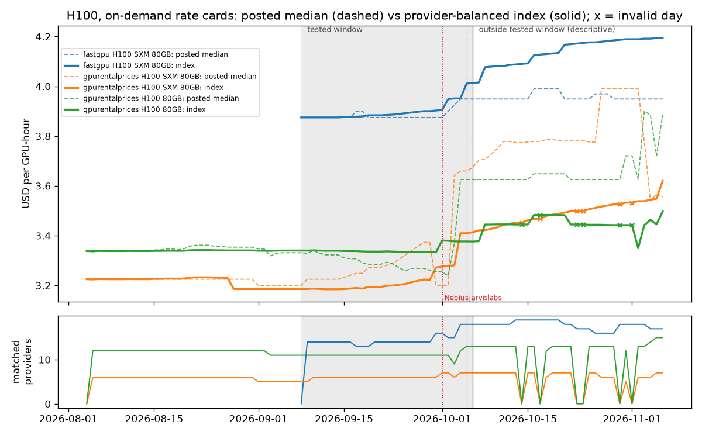
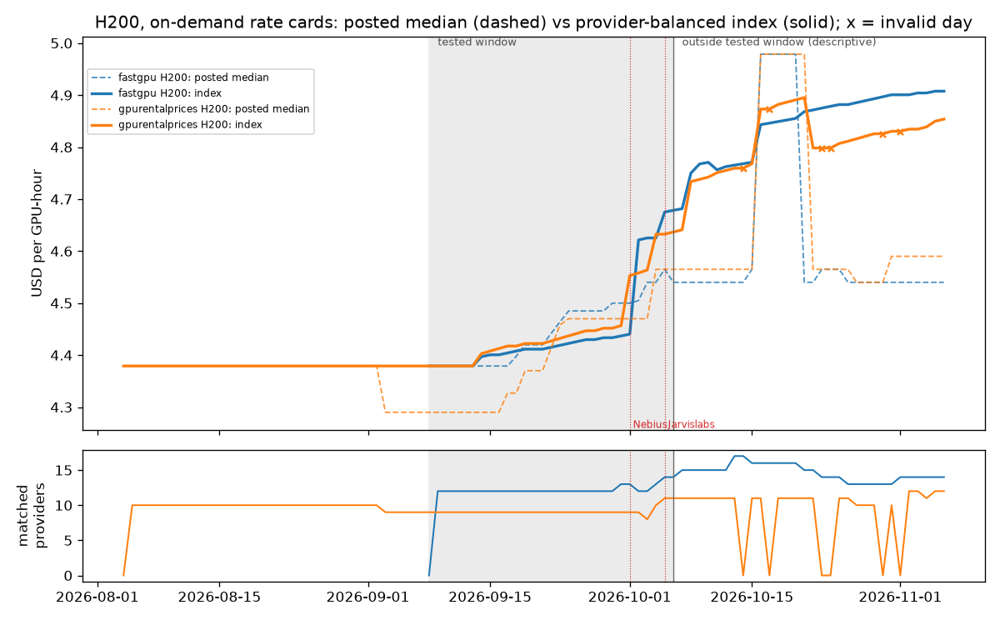
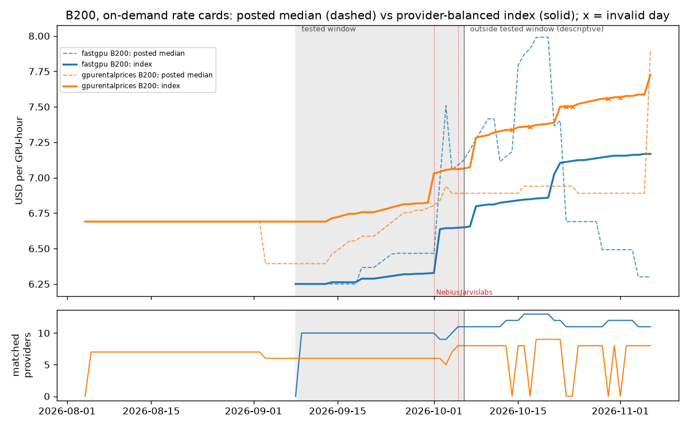
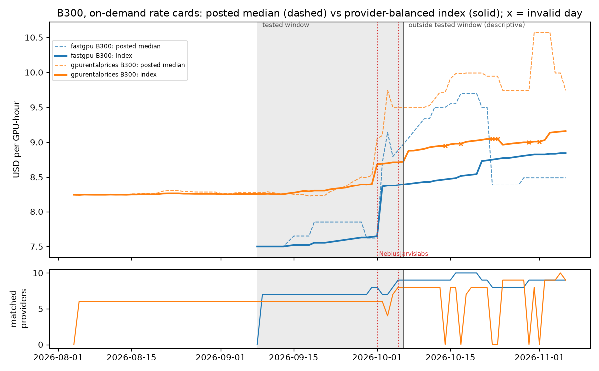
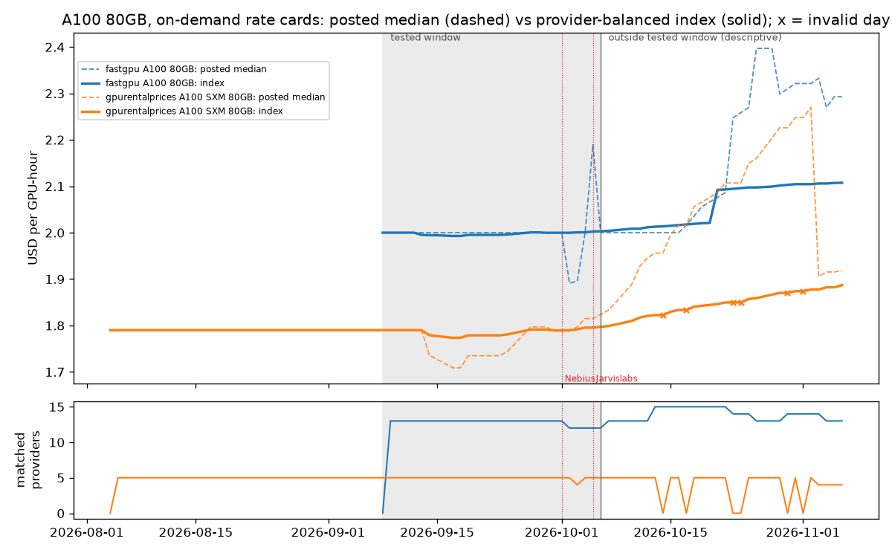

# A provider-balanced change index for GPU rental prices (slug `index`)

**Verdict: the frozen acceptance test passed on all four parts, and none of the drop checks fired.** The test used practice dates only: 22 target days from 15 Sep to 6 Oct 2026 and 11 GPU pairs quoted on both collectors. The sample is small, about three weeks plus one day. Collector agreement shows the two collectors are consistent with each other. It does not show either is correct: there are no transaction prices and no capacity weights.

Rules: [protocol.yaml](../protocol.yaml), written before any index number was computed. Code: [src/gpuf/index.py](../../../src/gpuf/index.py). Leak test: [tests/test_index.py](../../../tests/test_index.py). Test script: [acceptance.py](../acceptance.py). Numbers: [acceptance.json](acceptance.json).

## 1. What the index is

Each published rental price is the median of a short list of provider offers, 3 to 19 here. The median moves when one provider reprices. It also moves when an offer joins or leaves the list, even if nobody changed a price. The index measures only the first kind of move, and gives every provider one vote.

For each GPU model and collector, every day:

1. Take the offers listed both today and on the previous day with data (*matched offers*). An offer is a `gpuf.panel` key: provider, region, SKU and GPU count.
2. Collapse each provider to one number: the median log price change over its matched offers. A provider listing 22 Lambda SKUs or 12 Verda regions still counts once.
3. Average the providers with equal weights. That average is the day's change.
4. If fewer than **3** providers are matched, the change is set to 0 (the level carries over) and the day is flagged invalid. Calendar days without rows are handled the same way.
5. Chain the daily changes from an anchor. The anchor is the posted median on the panel's first day: 4 Aug for gpurentalprices, 8 Sep for fastgpu.

Pack fields used: `source_id`, `instrument_class` (= `neocloud_rate_card`), `pricing_tier` (= `on_demand`), `gpu_model`, `provider`, `region_raw`, `sku_raw`, `gpu_count`, `usd_per_gpu_hour`, `dt`. One alias is fixed by hand: `paperspace` → `digitalocean`. It never fires, because no collector lists both names. There is no outlier filter, no static/dynamic split and no survivor cohort. The value for day t reads only rows dated on or before t.

Every value comes with a warning block:
- matched providers and matched offers, plus the totals listed that day;
- the largest provider's share of the move, max|r_p| / Σ|r_p|;
- the one-provider-removal range: the largest change in that day's index move when any one provider is deleted.

**CLI:** `PYTHONPATH=src .venv/bin/python -m gpuf.index --gpu H100 --source gpurentalprices --to 2026-10-06`. A prefix such as `H100` prints every matching pack model. Add `--csv` to save the table.

**Causality check.** The test computes the index through 6 Nov twice: once on the real rows, and once after every row after day t is deleted, or corrupted with random price factors and fake providers. Everything up to t must match bit for bit. It does, for 4 panels × 3 cut days × 2 modes, including the provider-deleted paths. A planted look-ahead (anchoring at the last day) makes the test fail, so the test can catch a leak.

## 2. Acceptance test, line by line

Pairs: 9 with the same `gpu_model` on both collectors (A100 40GB, B200, B300, H100 SXM 80GB, H200, L40S, RTX 6000 Ada, RTX A6000, RTX PRO 6000) and 2 cross-name pairs: fastgpu A100 80GB ~ gpurentalprices A100 SXM 80GB, and fastgpu H100 SXM 80GB ~ gpurentalprices H100 80GB. That gives 242 pair-days. "7-day disagreement" is |7-day log change on fastgpu − 7-day log change on gpurentalprices|.

| Test | Threshold | Index | Posted median | Balanced median | Constant | Result |
|---|---|---|---|---|---|---|
| (a) mean abs. 7-day collector disagreement (log) | index ≤ 0.80 × posted | **0.0063** | 0.0319 | 0.0150 | 0 | **pass**: ratio 0.198, so 80% lower |
| (a) paired diff. index − posted, 90% week-block interval | descriptive | −0.0256 (−0.048, −0.011) | | balanced − posted −0.0169 (−0.042, −0.0001) | | 4 week blocks, the last only 1 day: rough |
| (b) mean worst change of the 7-day move when one provider is deleted (21 series × 22 days) | index < posted | **0.0081** | 0.0309 | 0.0197 | | **pass**; the index is lower on all 21 series |
| (c) right direction on Nebius (1 Oct) / Jarvislabs (5 Oct) cases | ≥ 80% of cases and mean retention > 0 | **14 of 14**, mean retention 0.169 (median 0.147) | 11 of 14, mean 0.236 (median 0.049) | 11 of 14, mean 0.160 (median 0.070) | 0 of 14 | **pass**; constant **fails** as required |
| (d) invalid days in window | report; drop if > 20% | 30 of 599 (5.0%) | | | | reported, below 20% |

Drop checks (protocol), none fired:
- **Inactivity.** The index moved on at least one side of every one of the 11 pairs, so the "active pairs" result equals the full result (ratio 0.198). Caveat: on fastgpu RTX 6000 Ada the index never moves, because only 2 providers are matched on all 28 days. That pair's agreement is partly one-sided inactivity. Dropping it gives 0.0057 (post hoc).
- **Provider duplication.** Each provider counts once by construction, and the alias map finds no conflict. On the 9 exact-name pairs (no reuse of fastgpu H100 SXM) the ratio is 0.208: index 0.0069 vs posted 0.0332. Pass.
- **Discarded hard days.** None were discarded. Invalid days carry the level and stay in the average.
- **Future-selected membership.** Membership is day-local, and the leak test passes.

### Responsiveness detail ([c_responsiveness.csv](c_responsiveness.csv))

A case counts if the provider has matched offers in the window (effective date −1 to +1) and its own move is at least 3%. Retention = index move over the window ÷ that provider's move.

| Panel | Provider | Provider move (log) | Matched providers | Index move | Posted-median move |
|---|---|---|---|---|---|
| fastgpu B200 | Nebius | 0.173 | 10 | 0.049 | 0.077 |
| fastgpu B300 | Nebius | 0.191 | 8 | 0.092 | 0.133 |
| fastgpu H100 SXM | Nebius | 0.156 | 16 | 0.012 | 0.007 |
| fastgpu H100 SXM | Jarvislabs | 0.260 | 18 | 0.016 | 0.006 |
| fastgpu H200 | Nebius | 0.182 | 13 | 0.042 | 0.001 |
| fastgpu H200 | Jarvislabs | 0.140 | 14 | 0.011 | 0.000 |
| fastgpu RTX PRO 6000 | Jarvislabs | 0.147 | 8 | 0.021 | 0.156 |
| grp B200 | Nebius | 0.173 | 6 | 0.032 | 0.010 |
| grp B300 | Nebius | 0.191 | 6 | 0.036 | 0.069 |
| grp H100 80GB | Nebius | 0.156 | 11 | 0.014 | **−0.007** |
| grp H100 SXM | Jarvislabs | 0.260 | 7 | 0.040 | 0.009 |
| grp H200 | Nebius | 0.182 | 9 | 0.024 | 0.000 |
| grp H200 | Jarvislabs | 0.140 | 11 | 0.016 | 0.021 |
| grp RTX PRO 6000 | Jarvislabs | 0.147 | 8 | 0.024 | 0.069 |

The index keeps about 1/N of one provider's move: the mean of 1/N is 0.108. It keeps a little more where other providers rose in the same days. That is the intended behaviour: one seller out of N raised its price. The posted median gives all or nothing. It passed 100% or more of Jarvislabs' move on fastgpu RTX PRO 6000, about 0% on four panels, and moved the wrong way on gpurentalprices H100 80GB.

### Paired differences by pair and by week ([d_by_pair.csv](d_by_pair.csv), [d_by_week.csv](d_by_week.csv))

| Pair | D index | D posted | D balanced | Index − posted |
|---|---|---|---|---|
| A100 40GB | 0.0021 | 0.1057 | 0.0091 | −0.1035 |
| A100 80GB ~ A100 SXM 80GB | 0.0032 | 0.0329 | 0.0238 | −0.0296 |
| B200 | 0.0071 | 0.0281 | 0.0175 | −0.0210 |
| B300 | 0.0151 | 0.0314 | 0.0328 | −0.0163 |
| H100 SXM ~ H100 80GB | 0.0044 | 0.0194 | 0.0112 | −0.0150 |
| H100 SXM | 0.0081 | 0.0283 | 0.0141 | −0.0202 |
| H200 | 0.0050 | 0.0077 | 0.0091 | −0.0027 |
| L40S | 0.0011 | 0.0018 | 0.0013 | −0.0006 |
| RTX 6000 Ada (fastgpu side never valid) | 0.0130 | 0.0262 | 0.0196 | −0.0133 |
| RTX A6000 | 0.0021 | 0.0479 | 0.0188 | −0.0458 |
| RTX PRO 6000 | 0.0083 | 0.0217 | 0.0084 | −0.0135 |

The index is lower on all 11 pairs. There are no "never moved" pairs: every pair had at least one side that moved.

| Target week | Days | D index | D posted | D balanced |
|---|---|---|---|---|
| 15 to 21 Sep | 7 | 0.0034 | 0.0145 | 0.0144 |
| 22 to 28 Sep | 7 | 0.0030 | 0.0131 | 0.0131 |
| 29 Sep to 5 Oct | 7 | 0.0112 | 0.0570 | 0.0167 |
| 6 Oct | 1 | 0.0168 | 0.1102 | 0.0215 |

The index is lower in every week. Most of the posted median's disagreement comes from the repricing week, 29 Sep to 6 Oct.

Invalid days ([d_coverage_by_series.csv](d_coverage_by_series.csv)): 28 on fastgpu RTX 6000 Ada (every day), 1 on gpurentalprices A100 40GB and 1 on gpurentalprices RTX 6000 Ada. On average 97 to 100% of listed providers were matched each day.

## 3. Post-hoc checks (written after the result; not part of the frozen test; [posthoc.json](posthoc.json))

The index moves less than the median: its mean absolute 7-day move is 0.0097, against 0.0269 for the posted median. Does it agree only because it is smaller? Three checks that do not depend on size:

| | Index | Posted median | Balanced median |
|---|---|---|---|
| correlation of the two collectors' 7-day changes (242 pair-days) | **0.72** | 0.04 | 0.60 |
| disagreement ÷ mean size of the 7-day move | **0.65** | 1.19 | 0.91 |
| D with Verda deleted on both collectors | 0.0045 | 0.0314 | |

The posted medians of the same chip on two collectors are essentially uncorrelated week to week (0.04). The index readings correlate at 0.72. Part of that is mechanical: the same providers (Nebius, Jarvislabs, Verda, Lambda) appear on both collectors, so their repricings show up in both indices. This is consistency, not truth.

## 4. What is weak or uncertain

- **Small sample.** 22 target days from about 3 calendar weeks, and the week-block interval rests on 4 blocks, one of them a single day. Two announced repricings (14 cases) carry the responsiveness test.
- **On most days one provider is the whole move.** Mean largest-provider share is 0.85 to 1.0 per series. Verda, which reprices on most days and mostly upward, is the most pivotal provider for the index on 17 of 21 series. The index publishes this rather than hiding it. A reader should treat a move whose largest-provider share is about 1 as one seller's repricing.
- **Where a panel is thin, the index is the median's weakness in a different form.** With 3 to 5 providers (A100 40GB, RTX A6000, RTX 6000 Ada), one repricer moves the index by a third to a fifth of its own move, and the panel can fall below 3 providers.
- **It is a change index, not a price level.** New entrants never set the level. Over time the chained level separates from the posted median (figures). From 8 Sep to 6 Nov, the fastgpu H100 SXM index rose 8.2% (3.87 to 4.19 USD) while its posted median rose 1.9% (3.87 to 3.95). The index follows continuing offers, and Verda's daily steps compound.
- **Chips listed under different names.** Two of the 11 pairs match different `gpu_model` strings. The 9-pair check gives the same result.

## 5. Descriptive extension to 6 Nov (outside the tested window)

[data_out/balanced_index.csv](../../../data_out/balanced_index.csv) has 2,435 rows: 33 of the 37 scored series, 4 Aug or 8 Sep to 6 Nov. The 4 afhubbard spot series are not in `gpuf.panel`. Columns: date, collector, GPU model, index level, daily change, providers, offers, largest-provider share, one-provider-removal range, valid flag. It also carries series id, class, tier, posted median, listed providers/offers, the largest provider's name, and two flags: `tested_contract` (False for spot and marketplace panels, which the test did not cover) and `in_tested_window`.

With no rule changed, on target days 14 Oct to 6 Nov (264 pair-days, descriptive only): disagreement is index 0.0070, posted 0.0527, balanced 0.0219 ([extension_descriptive.json](extension_descriptive.json)). 11.8% of rate-card series-days are invalid there, mostly the six calendar days gpurentalprices has no rows.

Figures. Grey band = tested window. Dotted red lines = Nebius and Jarvislabs effective dates. × = invalid day. Lower panel = matched providers.







## 6. How a lessor, a lender and a reserved-capacity buyer would use this

Written only from what was measured above. There is no haircut rule, no claim that either collector is right, and no claim about realised revenue.

**Lessor pricing a GPU lease.** If a lease escalates with "the market rate", tie the escalation to the index's change, not the posted median's. In the tested window, two collectors' 7-day readings of the same chip differed by 0.6% on average for the index and 3.2% for the posted median. The index also moved the right way in all 14 announced-repricing cases, against 11 of 14 for the median. The index does not give a starting level. That must still come from the spread of provider prices, which the earlier insight report shows is wide (p75/p25 about 1.3 to 2.2).

**Lender marking GPUs held as collateral.** Read the posted median and the index side by side. When the median jumps and the index does not, the list changed, not the prices. Example: on gpurentalprices H100 80GB the posted median rose 11% from 2 to 4 Oct (3.24 to 3.63 USD) as listed offers went from 11 to 14. The index was flat (3.38). Before re-marking on any move, check the warning block. A move with largest-provider share near 1 and a one-provider-removal range equal to the move is one seller's repricing. On thin panels (3 to 5 providers) the index itself rests on few sellers.

**Reserved-capacity buyer.** When a provider announces a rise, the index shows how much of the market that is. Nebius's +17% on H100 moved the fastgpu H100 SXM index by 1.2%, because 16 providers were matched. On fastgpu B300, with 8 providers, it moved 9%, partly because others rose too. If a seller cites "market rates are up", compare its proposed step with the index change over the same dates, and with the number of providers behind it.

## 7. Reproduce

```bash
export OMP_NUM_THREADS=2
PYTHONPATH=src .venv/bin/python -m pytest tests/test_index.py -q             # leak test + rule test (about 4 s)
PYTHONPATH=src .venv/bin/python experiments/index/acceptance.py              # frozen acceptance test (about 3 s)
PYTHONPATH=src .venv/bin/python experiments/index/posthoc.py                 # post-hoc scale-free checks
PYTHONPATH=src .venv/bin/python experiments/index/extend.py                  # data_out/balanced_index.csv + figures
PYTHONPATH=src .venv/bin/python -m gpuf.index --gpu H100 --source gpurentalprices --to 2026-10-06
```
