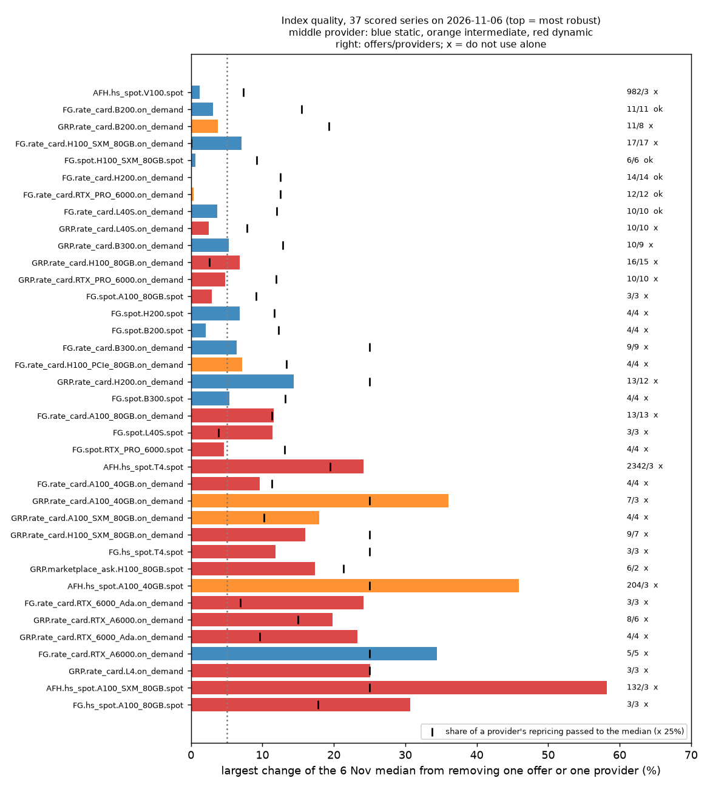
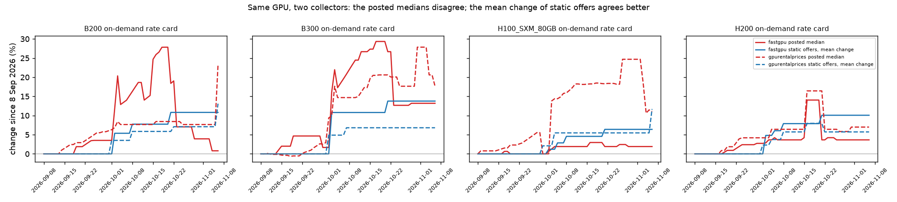
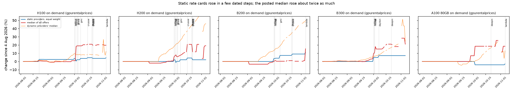
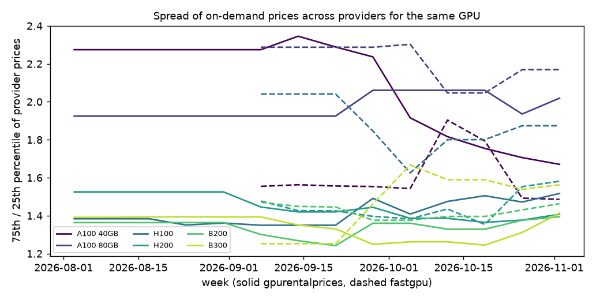
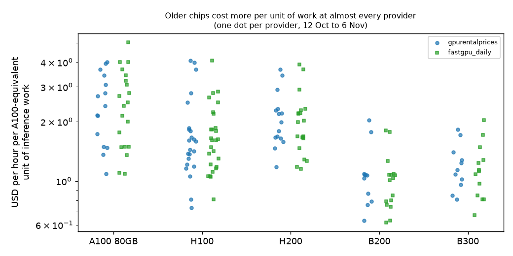

# Who is in the panel: index quality of posted GPU rental medians (slug `insight`), corrected copy v2

**What this copy changes (14 Nov 2026, slug `longrun3`).** `insight.md` is kept unchanged. This copy:
- states that the static/dynamic classification uses hindsight, and what that means for using it as a rule (Definitions);
- corrects the count of static pairs that never moved, and separates the active pairs from the inactive ones (s2);
- adds the v2 backtest result for the per-unit premium trend (s5);
- rewords the lessor, lender and buyer recommendations as conditions (s6);
- points to `experiments/index/` for an implementable index (s2, s6).

All other numbers and tables are unchanged from `insight.md` and come from `experiments/insight/analysis.py`. The new numbers in s2 come from `experiments/longrun/code/insight_v2_check.py`, which reads `t2_cross_collector.csv`, and are saved in `experiments/longrun/results/v3_insight_check.json`.

Data: gpu-price-pack v0.1.1-handover, `rental_observations` for fastgpu_daily (8 Sep to 6 Nov 2026), gpurentalprices (4 Aug to 6 Nov) and afhubbard (last 23 days, hyperscaler spot), plus `data_out/repricing_calendar.jsonl`. Descriptive work only. It reads rows up to the 6 Nov cutoff, writes nothing that a forecaster reads, and reports no forecast accuracy.
Reproduce (about 5 seconds): `OMP_NUM_THREADS=2 PYTHONPATH=src .venv/bin/python experiments/insight/analysis.py && .venv/bin/python experiments/insight/figures.py`. The expectations were written before any computation, in `protocol.yaml`.

Definitions. An *offer* is a persistent (provider, region, SKU, GPU count) row from `gpuf.panel`. A provider's *reprice rate* is the share of its offer-days with a price change, computed per collector. A provider is *dynamic* if its reprice rate is 0.15 or more, *static* if it is below 0.02, and *intermediate* in between. *Static* is classified over the provider's whole sample. The flag on the middle offer uses the trailing 21 days. Verda's rate is 0.71 on fastgpu and 0.75 on gpurentalprices, and 98% of its changes are increases. Scaleway's is 0.80, Runcrate's 0.36, AWS spot's 0.38. Lambda's is 0.04 and Nebius's 0.

**Hindsight in the classification.** A provider's static, intermediate or dynamic label uses all of its offer-days up to 6 Nov, including days after any date at which a statistic is evaluated. For example, a provider that held its price until October and then started repricing daily would be labelled by its whole record. The "static" statistics in s2 and s3 therefore show what a static-provider index *would have done* with membership known in advance. They do not show what a rule could have done in real time. To use the classification as a rule, a provider's label on day t must come only from days before t (for example, a trailing window), and the index must state what happens when a label changes. That version has not been built or tested here. A causal, provider-balanced index with a frozen missing-offer rule is being built in `experiments/index/`, which is the implementable version. Do not read the s2 agreement numbers as that index's performance.

## 1. Index quality card, 6 Nov 2026 (`t1_index_quality_card.csv`, fig1)

Each scored median is the median of 3 to 17 offers. Only the afhubbard spot series have more (132 to 2,342 availability-zone rows), but those rows come from only 3 hyperscalers. The card gives five measures for each series:

- **One-offer removal**: the largest move of the median when one offer is removed.
- **One-provider removal**: the largest move when all of one provider's offers are removed.
- **Pass-through**: the share of a +10% repricing by one provider that reaches the median. The card reports the largest share over providers.
- **Neighbour gap**: the gap between the order statistics on either side of the middle.
- **IQR**: the interquartile spread.

The ranking uses this score: worst removal % + half the neighbour gap + 10 × max pass-through + 10 if the middle provider is dynamic + 5 if there are fewer than 5 providers. A series is marked "do not use alone" if any of these holds: worst removal above 5%, pass-through of 0.75 or more, a dynamic middle provider, or fewer than 5 providers.

| # | series | offers/providers | middle provider (21-d reprice rate) | worst one-offer / one-provider removal % | max pass-through (provider) | neighbour gap % | IQR % | days moved, last 60 | use alone? |
|---|---|---|---|---|---|---|---|---|---|
| 1 | afh.hs_spot.V100.spot | 982/3 | oci (0.00) | 0.0 / 1.2 | 0.29 (oci) | 0.0 | 36 | 9% | no |
| 2 | fg.rate_card.B200.od | 11/11 | openrelay (0.00) | 3.1 / 3.1 | 0.62 (modal) | 7.0 | 38 | 46% | yes |
| 3 | grp.rate_card.B200.od | 11/8 | lambdalabs (0.04) | 0.6 / 3.8 | 0.77 (lambdalabs) | 2.5 | 17 | 37% | no |
| 4 | fg.rate_card.H100_SXM_80GB.od | 17/17 | daytona (0.00) | 7.1 / 7.1 | 0.00 (hyperstack) | 14.2 | 38 | 15% | no |
| 5 | fg.spot.H100_SXM_80GB.spot | 6/6 | daytona|vultr (0.00) | 0.7 / 0.7 | 0.37 (daytona) | 19.6 | 15 | 8% | yes |
| 6 | fg.rate_card.H200.od | 14/14 | daytona|modal (0.00) | 0.0 / 0.0 | 0.50 (daytona) | 20.5 | 50 | 25% | yes |
| 7 | fg.rate_card.RTX_PRO_6000.od | 12/12 | exoscale|quantacloud (0.05) | 0.4 / 0.4 | 0.50 (quantacloud) | 25.4 | 40 | 44% | yes |
| 8 | fg.rate_card.L40S.od | 10/10 | ovhcloud|vultr (0.00) | 3.7 / 3.7 | 0.48 (vultr) | 21.3 | 23 | 32% | yes |
| 9 | grp.rate_card.L40S.od | 10/10 | digitalocean|scaleway (0.80) | 2.5 / 2.5 | 0.31 (digitalocean) | 10.6 | 24 | 33% | no |
| 10 | grp.rate_card.B300.od | 10/9 | nebius|together (0.00) | 2.5 / 5.3 | 0.51 (together) | 22.9 | 27 | 59% | no |
| 11 | grp.rate_card.H100_80GB.od | 16/15 | crusoe|runcrate (0.36) | 0.4 / 6.8 | 0.10 (runcrate) | 14.9 | 38 | 51% | no |
| 12 | grp.rate_card.RTX_PRO_6000.od | 10/10 | massedcompute|runcrate (0.36) | 4.8 / 4.8 | 0.48 (massedcompute) | 13.5 | 32 | 35% | no |
| 13 | fg.spot.A100_80GB.spot | 3/3 | verda (0.71) | 2.9 / 2.9 | 0.37 (verda) | 9.5 | 5 | 10% | no |
| 14 | fg.spot.H200.spot | 4/4 | daytona|together (0.00) | 6.8 / 6.8 | 0.47 (daytona) | 21.7 | 16 | 29% | no |
| 15 | fg.spot.B200.spot | 4/4 | coreweave|together (0.00) | 2.1 / 2.1 | 0.49 (together) | 31.7 | 11 | 37% | no |
| 16 | fg.rate_card.B300.od | 9/9 | openrelay (0.00) | 6.4 / 6.4 | 1.00 (openrelay) | 24.7 | 34 | 32% | no |
| 17 | fg.rate_card.H100_PCIe_80GB.od | 4/4 | ovhcloud|quantacloud (0.05) | 7.2 / 7.2 | 0.54 (ovhcloud) | 28.3 | 18 | 8% | no |
| 18 | grp.rate_card.H200.od | 13/12 | jarvislabs (0.00) | 7.2 / 14.4 | 1.00 (jarvislabs) | 15.5 | 33 | 18% | no |
| 19 | fg.spot.B300.spot | 4/4 | coreweave|together (0.00) | 5.4 / 5.4 | 0.53 (together) | 36.0 | 17 | 29% | no |
| 20 | fg.rate_card.A100_80GB.od | 13/13 | verda (0.71) | 11.6 / 11.6 | 0.45 (verda) | 27.8 | 53 | 36% | no |
| 21 | fg.spot.L40S.spot | 3/3 | verda (0.71) | 11.4 / 11.4 | 0.15 (verda) | 24.3 | 12 | 44% | no |
| 22 | fg.spot.RTX_PRO_6000.spot | 4/4 | hyperstack|verda (0.71) | 4.6 / 4.6 | 0.52 (hyperstack) | 38.5 | 17 | 32% | no |
| 23 | afh.hs_spot.T4.spot | 2342/3 | aws|azure (0.47) | 0.1 / 24.2 | 0.78 (gcp) | 0.3 | 92 | 59% | no |
| 24 | fg.rate_card.A100_40GB.od | 4/4 | lambdalabs|verda (0.71) | 9.6 / 9.6 | 0.45 (verda) | 37.4 | 24 | 54% | no |
| 25 | grp.rate_card.A100_40GB.od | 7/3 | lambdalabs (0.04) | 0.0 / 36.0 | 1.00 (lambdalabs) | 0.0 | 8 | 16% | no |
| 26 | grp.rate_card.A100_SXM_80GB.od | 4/4 | crusoe|hyperstack (0.04) | 17.9 / 17.9 | 0.41 (hyperstack) | 48.0 | 39 | 65% | no |
| 27 | grp.rate_card.H100_SXM_80GB.od | 9/7 | scaleway (0.80) | 16.0 / 16.0 | 1.00 (scaleway) | 33.8 | 45 | 63% | no |
| 28 | fg.hs_spot.T4.spot | 3/3 | aws (0.38) | 11.8 / 11.8 | 1.00 (aws) | 36.0 | 18 | 42% | no |
| 29 | grp.marketplace_ask.H100_80GB.spot | 6/2 | lium (0.26) | 9.3 / 17.3 | 0.85 (lium) | 34.7 | 31 | 63% | no |
| 30 | afh.hs_spot.A100_40GB.spot | 204/3 | gcp (0.11) | 0.0 / 45.9 | 1.00 (gcp) | 0.0 | 29 | 9% | no |
| 31 | fg.rate_card.RTX_6000_Ada.od | 3/3 | verda (0.71) | 24.1 / 24.1 | 0.27 (verda) | 51.0 | 26 | 71% | no |
| 32 | grp.rate_card.RTX_A6000.od | 8/6 | runcrate|verda (0.75) | 19.8 / 19.8 | 0.60 (verda) | 73.1 | 76 | 43% | no |
| 33 | grp.rate_card.RTX_6000_Ada.od | 4/4 | runcrate|verda (0.75) | 23.3 / 23.3 | 0.38 (runcrate) | 62.3 | 51 | 73% | no |
| 34 | fg.rate_card.RTX_A6000.od | 5/5 | hyperstack (0.00) | 34.4 / 34.4 | 1.00 (hyperstack) | 72.8 | 73 | 27% | no |
| 35 | grp.rate_card.L4.od | 3/3 | scaleway (0.80) | 25.1 / 25.1 | 1.00 (scaleway) | 63.4 | 32 | 69% | no |
| 36 | afh.hs_spot.A100_SXM_80GB.spot | 132/3 | gcp (0.17) | 0.0 / 58.2 | 1.00 (gcp) | 0.0 | 78 | 27% | no |
| 37 | fg.hs_spot.A100_80GB.spot | 3/3 | aws (0.38) | 30.7 / 30.7 | 0.71 (aws) | 68.5 | 34 | 53% | no |

**Reading the card.** Five of the 37 series pass every test: the fastgpu rate-card medians for B200, H200, L40S and RTX PRO 6000, and fastgpu H100 SXM neocloud spot. No H100 or A100 on-demand series passes. The other 32 fail as follows:

- **25 series** move more than 5% if one offer or one provider is removed. The median worst removal is 7.2%, interquartile 3.8 to 19.8%.
- **20 series** have fewer than 5 providers.
- **18 series** have a dynamic repricer holding the middle offer.
- **12 series** have one provider that passes 75% or more of its own repricing into the median. In effect, that provider sets the index.

The extreme cases:

- **gpurentalprices A100 40GB** is Lambda's price list. Lambda holds 5 of the 7 offers; removing Lambda moves the median 36%.
- **afhubbard A100 SXM 80GB spot** is GCP's price. The median falls on a GCP row, and removing GCP moves it 58%, although the panel has 132 rows.
- **gpurentalprices H100 SXM 80GB** is Scaleway's price. Scaleway reprices on 80% of days. The median moved on 63% of the last 60 days, and removing one offer moves it 16%.
- **gpurentalprices H200** is Jarvislabs' price. Pass-through is 1.00, and removing Jarvislabs moves the median 14%.

The best H100 on-demand series is fastgpu H100 SXM: 17 offers from 17 providers and a static middle (Daytona) with pass-through 0. It still moves 7.1% if one offer leaves, because the gap between the neighbouring offers is 14% of the median. Across series, the share of days a median moved has a Spearman correlation of 0.49 with its middle provider's reprice rate.

## 2. Market-wide or panel-specific? (`t2_cross_collector.csv`, `t2b`, fig2)

I took 11 GPU pairs quoted on both collectors, 8 Sep to 6 Nov (59 daily changes). For each I compared the posted medians with four panel-robust statistics: the median over offers present on both days (balanced), the median of offer-level changes, the median of static offers only, and the mean change of static offers ("static mean").

| statistic | days it moves (fg / grp) | mean abs. 7-day disagreement between collectors (log) | difference from posted median, 90% week-block CI |
|---|---|---|---|
| posted median | 36% / 43% | 0.048 | |
| balanced median | 29% / 35% | 0.019 | −0.029 (−0.043, −0.015) |
| static median, same offers | 0.9% / 1.5% | 0.005 | −0.044 (−0.057, −0.031) |
| static mean, same offers | 3.1% / 3.1% | 0.005 | −0.043 (−0.057, −0.030) |

The robust statistics move less and agree far better across collectors. Composition (balanced versus posted) accounts for about 60% of the 7-day disagreement. The dynamic providers account for most of the rest. The static numbers flatter themselves, though, because many pairs were inactive.
- **Inactive pairs.** On the static median, 5 of the 11 pairs never moved on either collector (A100 40GB, A100 80GB, L40S, RTX 6000 Ada, RTX A6000). A sixth, RTX PRO 6000, never moved on fastgpu. So in 6 of 11 pairs at least one collector's static median was flat for the whole window. On the static mean, 4 pairs never moved on either collector, and A100 80GB moved on one collector only.
- **What that does to the numbers.** On those pairs the two collectors agree because nothing happened, so the low static disagreement is partly inactivity. Restricted to the 6 pairs where the static median moved, its 7-day disagreement is 0.0085, not 0.0047 over all 11. On the same 6 pairs the posted median's is 0.034 and the balanced median's 0.017. Restricted to the 7 active pairs on the static mean, it is 0.0084, against 0.037 for the posted median.
- **Conclusion.** The static statistics still agree better than the posted median on the active pairs, by about three quarters. That gain is in-sample, uses the hindsight classification above, and has no interval on the active-pair subset.

The informative cases are the four frontier pairs. Their total change from 8 Sep to 6 Nov, as fastgpu / gpurentalprices in log points:

| pair | posted medians | static mean |
|---|---|---|
| B200 | 0.8 / 20.9 | 10.3 / 12.3 |
| H100 SXM | 1.9 / 10.5 | 6.2 / 11.1 |
| B300 | 12.4 / 16.3 | 12.9 / 6.6 |
| H200 | 3.6 / 6.8 | 9.6 / 5.6 |

The mean absolute gap between collectors falls from 9.0 to 4.3 log points; it does not vanish. Part of the remaining gap is real: the two collectors list different static providers (fastgpu has GMI, DeepInfra and fal; gpurentalprices has Lambda's multi-GPU SKUs). The median of static offers is no fix. It is still a median: on B200 it agreed only because Nebius moved fastgpu's on 1 Oct and Lambda moved gpurentalprices' on 6 Nov (fig2). **Verdict: supported, with a qualification.** Composition and the dynamic providers are mostly noise around a common movement. That common movement is about 6 to 12% over two months on frontier chips. The posted medians report anything from 1% to 21% for it.

## 3. The level and trend that survive: static rate cards (`t3a_static_steps.csv`, `t3b_static_breadth.csv`, fig3)

On-demand, static providers present on both dates, gpurentalprices 4 Aug to 6 Nov:

| chip | static providers | up / down / flat | median change | mean change | posted median, all offers | dynamic providers' median |
|---|---|---|---|---|---|---|
| H100 (all SKUs) | 15 | 5 / 0 / 10 | 0.0% | +9.1% | +19.8% | +12.3% |
| H200 | 9 | 3 / 0 / 6 | 0.0% | +6.1% | +19.1% | +46.1% |
| B200 | 6 | 3 / 0 / 3 | +8.3% | +9.7% | +15.5% | +49.6% |
| B300 | 4 | 1 / 0 / 3 | 0.0% | +4.9% | +21.1% | +24.5% |
| A100 80GB | 10 | 1 / 1 / 8 | 0.0% | +0.8% | +18.5% | +13.0% |
| A100 40GB | 3 | 0 / 0 / 3 | 0.0% | 0.0% | 0.0% | +28.4% |

fastgpu, 8 Sep to 6 Nov, H100: 6 of 13 static providers up, mean +10.1%, while the posted median moved only +1.3%. Composition biases the headline in either direction.

The steps, each 10% or more, on these chips (`t4a_large_static_steps.csv`):

| date | provider | size | calendar entry |
|---|---|---|---|
| 22 Aug | Thunder Compute, H100 | +46% | none |
| 1 to 2 Oct | Nebius, H100 / H200 / B200 / B300 | +17 to +21% | announced 16 Sep, effective 1 Oct (15 days) |
| 2 Oct | fal, H200 / B200 / B300 | +28 to +53% | none |
| 4 to 5 Oct | Jarvislabs, H100 / H200 | +30% / +15% | announced 24 Sep, effective 5 Oct (11 days) |
| 7 Oct | Daytona, B300 | +14% | none |
| 8 Oct | GMI, H100 / H200 / B200 | +23 to +30% | none |
| 16 Oct | Crusoe, H100 / H200 | +15% / +26% | none; reversed 21 to 22 Oct |
| 21 Oct | DeepInfra, all five chips | +20 to +67% | none |
| 6 Nov | Lambda, H100 / A100 80GB / B200 (gpurentalprices only) | +14 to +15% | announced 6 Nov, "effective 16 Nov" |

**The 2026 rise is narrow and stepwise.** On H100 and H200, a third of static rate-card providers raised prices and none cut. The typical static provider (the median) did not change its price over three months. The steps cluster in one five-week window, 1 Oct to 6 Nov: 8 of the 9 up-steps fall in it. The posted medians rose about twice as much as the static mean, through composition and through Verda's daily increases. The trend that survives is roughly +5 to +10% on H100, H200, B200 and B300 rate cards over August to early November, carried by 1 to 6 providers per chip. A100 rate cards were flat.

## 4. What the provider mix implies for horizon (`t4b_calendar_gpu_entries.csv`, `t4c_lambda_nov16_counterfactual.csv`)

- **Announced ahead with a date:** 2 of the 9 large static up-steps (22%, 90% Wilson interval 8 to 50%). Nebius had a 15-day lead and Jarvislabs an 11-day lead, and both appeared in the data on the effective date or one day early. A third, Lambda, was announced on 6 Nov with "effective 16 Nov", but gpurentalprices already listed the new rates on 6 Nov, so its lead in the data was zero. The other GPU entries in the calendar fall outside these chips' rate-card panels: DigitalOcean (reported a day after the fact), Fireworks (19 days ahead) and AWS capacity blocks (7 days ahead). Dynamic providers announce nothing; they make 84% of fastgpu reprices.
- **Lambda, 16 Nov:** the step is already in the 6 Nov value on gpurentalprices. The B200 median rose 14.5% (6.89 to 7.89) and the H100 80GB median 4.3% that day. On fastgpu, Lambda's offers still showed the old rates on 6 Nov. Applying the announced rates changes none of the five fastgpu medians that contain Lambda (0.0% each), because Lambda does not hold the middle offer in any of them. So the claim that a 30-day mark gains from Lambda's 16 Nov rise is wrong for these medians. A 1 to 7 day forecast already has the step in its last value, and a 30-day mark does not move. The calendar matters for a *Lambda contract*, not for a median index.
- **Where a calendar does help:** an announcement passes through to a median only if the announcing provider's pass-through is high. Nebius and Jarvislabs did reach the middle in October: removing them cut the last-value loss of the affected dev cells by 38%, which is 8.6% of total dev last-value loss (`experiments/calendar/results/partb_summary.json`). Jarvislabs now holds the middle of gpurentalprices H200 with pass-through 1.00. A lender marking at 30 days should read the card first: a dated announcement from a provider with pass-through near 1 is a near-certain mark change. One with pass-through near 0 is no change.

## 5. Dispersion across providers and the per-unit premium (`t5a`, `t5b`, `t5c`, fig4, fig5)

 

One price per provider (median over its offers), on-demand rate cards and hyperscaler list prices, 12 Oct to 6 Nov:

| chip | providers (grp / fg) | p75 / p25, grp (90% bootstrap) | p75 / p25, fg | max / min (grp / fg) |
|---|---|---|---|---|
| B200 | 11 / 16 | 1.31 (1.04 to 2.05) | 1.38 (1.14 to 1.79) | 3.2 / 2.9 |
| B300 | 11 / 13 | 1.35 (1.16 to 1.73) | 1.51 (1.16 to 2.03) | 2.3 / 3.0 |
| H200 | 15 / 20 | 1.39 (1.23 to 1.91) | 1.39 (1.30 to 1.85) | 3.1 / 3.4 |
| H100 | 23 / 27 | 1.46 (1.28 to 2.38) | 1.69 (1.37 to 2.10) | 5.6 / 5.0 |
| A100 40GB | 6 / 9 | 1.73 (1.07 to 2.78) | 1.76 (1.09 to 2.39) | 3.8 / 3.8 |
| A100 80GB | 15 / 20 | 2.02 (1.41 to 2.42) | 2.20 (1.52 to 2.54) | 3.7 / 4.6 |

The law of one price is far from holding, and it fails worst for older chips. The interquartile ratio is 1.3 to 1.5 for Blackwell and 2.0 to 2.2 for A100 80GB. Over the 14 weeks it was stable for B200 and H200. It rose for H100 on gpurentalprices (1.38 to 1.52) and fell for A100 40GB (2.27 to 1.67). These are 1 to 3 week shifts driven by single providers, not trends.

Per unit of inference work (capability units A100 = 1, H100 2.46, H200 2.72, B200 7.91, B300 8.77, from the longrun section), the old-chip premium holds at almost every provider pair, not just at the median. An A100 80GB offer is cheaper per unit than a B200 offer in 5 to 6% of the (A100 provider, B200 provider) pairs. For H100 the share is 14 to 20%, for H200 7 to 9%. The median ratio is 2.25 to 2.39 for A100 over B200 and 1.49 to 1.57 for H100. Even the cheapest H100 costs 0.69 to 0.79 times the median B200 per unit, and the cheapest A100 costs 1.02 to 1.07 times. Two consequences for residual value:

1. The generational premium (about 2.3x for A100) is about as large as the within-chip spread (p75/p25 about 2.1x). A single A100 quote can therefore sit anywhere between "at parity with Blackwell" and "twice the median". As a residual-value input it carries an error of a factor of about 1.5 each way.
2. The premium is not a quoting artefact of a few expensive providers. It holds across the whole distribution, so it reflects what renters pay for availability, software and small jobs. Longrun version 1 fitted a shrinking premium for A100 on GetDeploying: −21% a year (90% CI −35 to −3) over 52 weeks. Longrun version 2's backtest (b) found that such a fitted trend does not predict. It beat no-change on 4 of 12 series, though the premium did fall on 9 of 12 (`experiments/longrun/results/longrun.md` s3). The direction is informative but the slope is not. A residual model should start from the provider distribution, not from one quote.

## 6. Recommendations, worded as conditions

These are descriptive findings from one window (Aug to 6 Nov 2026), on posted asks, with the hindsight classification above. None is a tested decision rule. No haircut, advance rate or index here has been calibrated against realised revenue, transactions, defaults or recoveries.

**Lessor (pricing an H100 or A100 lease)**
1. **Benchmark choice.** 32 of the 37 series are marked "no" on the card. They include every H100 and A100 on-demand median, whose worst one-offer or one-provider removal moves the median by 7% to 36%. A lease indexed to one of them carries that membership risk on top of any market move. If an index is wanted, the equal-weight change of a fixed set of static rate cards agreed better across collectors in this window: 0.005 log per week against 0.048 for the posted median, or 0.008 against 0.034 to 0.037 on the pairs that moved (s2). That set was chosen with hindsight. The implementable, causal version is the provider-balanced index in `experiments/index/`, and its own test results should be used instead of these numbers.
2. **Repricing.** In this window static competitors moved in 9 large steps and the typical one did not move. A lessor that matches the posted median day by day mostly follows Verda's daily moves. Whether stepwise repricing earns more was not tested.
3. **A100 pricing.** The A100 provider distribution spans 2.0 to 2.2 times from p25 to p75, and a median can sit on one provider's list (Lambda holds 5 of 7 offers on gpurentalprices A100 40GB). A quote at "the median" is therefore weak evidence of the market rate. Use the distribution, with the provider count shown.

**Lender (marking GPUs held as collateral)**
1. **Mark sensitivity, not a haircut.** The card's worst one-offer or one-provider removal (7% for the median series, up to 58% on afhubbard A100 SXM spot) measures how far a mark can move from panel membership alone, on 6 Nov. It is a removal sensitivity. It is not a calibrated collateral haircut, which would also need price risk over the holding period, liquidity and recovery data, none of which is here. A hyperscaler-spot median can be set by one hyperscaler, so it is a poor market mark on its own.
2. **Announcements.** An announced repricing changes a median only when the announcing provider sits near the middle. Lambda's 16 Nov rise moves 0 of 5 fastgpu medians. A Jarvislabs change would pass 100% into gpurentalprices H200. Weighting calendar entries by pass-through follows from that arithmetic. Its forecast value rests on two development episodes (s4).
3. **The 2026 rise.** On the same static offers the rise was narrow: a third of static providers, about +5 to +10% on the static mean, against +15 to +21% on posted medians. This describes posted asks over three months, not realised rents or a trend. How it should enter a loan-to-value is a lender's judgement. `experiments/longrun/results/longrun_v3.md` shows how strongly any income-based cover depends on utilisation and realised rate.

**Reserved-capacity buyer**
1. **Benchmarking a quote.** On H100, the posted median rose about 10 points more than the static mean change since August (gpurentalprices). A quote that matches the headline median can therefore be about 10 points dearer than the static providers' prices. The static distribution is a better comparison, with the same hindsight caveat.
2. **Notice.** 2 of the 9 recent large static steps came with dated notice, of 11 and 15 days, from Nebius and Jarvislabs. That is too few to estimate how often notice comes.
3. **Price per unit of work.** On posted asks in the last four weeks, A100 costs about 2.3 times B200 per unit of inference work and H100 about 1.5 times. Fewer than 6% of A100-versus-B200 provider pairs reverse that. This is a measurement of asks on capability units from MLPerf inference, not a forecast. An older chip is the better buy only if the job cannot use the newer one, for example because of memory fit or availability.

## What is measured and what is assumed

Measured, from pack rows to 6 Nov:
- panel membership and prices on 6 Nov;
- removal and pass-through on that panel;
- reprice rates;
- cross-collector changes and their week-block intervals;
- static steps and their dates;
- Lambda's 6 Nov listing on gpurentalprices;
- dispersion and its provider-bootstrap intervals;
- the per-unit pair shares.

Assumed:
- **The static/dynamic threshold (0.02 / 0.15)**, taken over the whole sample (hindsight; see Definitions). Crusoe and Quantacloud stepped up and back within a week and still count as static or intermediate.
- **Equal weights** for providers. Capacity shares are unknown, so "a third of providers" is not "a third of supply".
- **The calendar is complete for these providers.** It came from dated web search; a missing entry is not proof that nothing was announced.
- **Lambda's fastgpu offers will update to the announced rates.** The counterfactual applies them to the 6 Nov panel with every other offer held fixed.
- **Capability units**, taken from the longrun section's central set (MLPerf inference, cross-benchmark median).
- **The ranking weights** on the card: a judgement, not an estimate.
