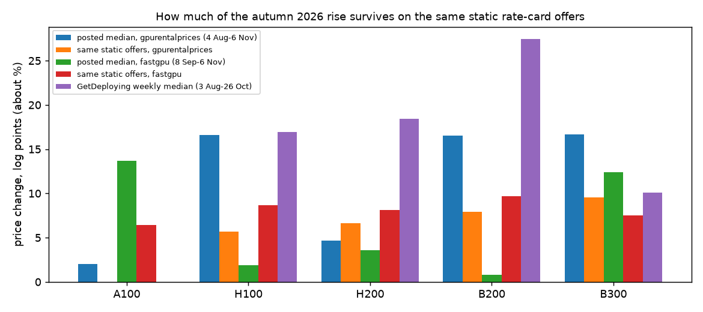
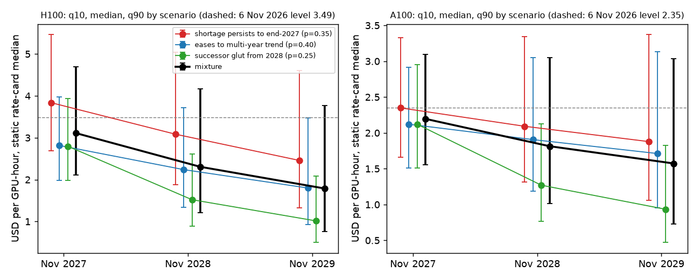
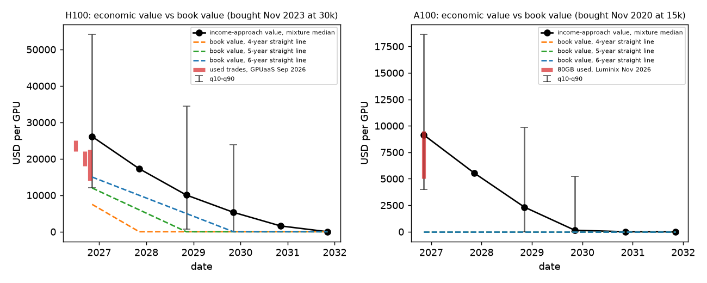

# H100 and A100 rent and resale in 2 to 3 years, version 2 (slug `longrun`)

Data: gpu-price-pack v0.1.1-handover, rows to 2026-11-06. AWS spot ends 2026-10-31. BLS PPI is used through Sep 2026; the Oct 2026 print was published after the cutoff and is excluded.
Version 1 is in `longrun_v1.md`. The scenarios, their probabilities and the backtest predictions were frozen in `../protocol_v2.yaml` before anything was computed.
Reproduce (about 3 minutes): `OMP_NUM_THREADS=2 .venv/bin/python experiments/longrun/code/aws.py && .venv/bin/python experiments/longrun/code/panel_v2.py && .venv/bin/python experiments/longrun/code/scen_v2.py && .venv/bin/python experiments/longrun/code/figures_v2.py`.

## Answer in five lines

1. **Rent, H100** (median of static neocloud rate cards, 3.49 USD/GPU-h on 6 Nov 2026): **2.3 at +24 months (q10 1.2, q90 4.2), 1.8 at +36 months (0.8 to 3.8)**.
2. **Rent, A100 80GB** (same instrument, 2.35 today): **1.8 at +24 months (1.0 to 3.1), 1.6 at +36 months (0.7 to 3.0)**.
3. **Resale, income approach:** H100 **26k USD per GPU now (12k to 54k), 10k at +24 months, 5k at +36 months**. A100 **9k now (4k to 19k), 2k at +24 months, about 0 at +36 months**. The published used figures (H100 18k to 22k, A100 80GB 5k to 9.5k) sit inside the q10 to q90 range and below the H100 median.
4. **Lending:** the q10 path supports a loan-to-value of **about 65% of the 20k used price** on 24 or 36-month H100 loans. That is the low edge of the 60 to 70% advance rates reported in the market. **A 35% residual is the median case at 24 months, not a conservative case at 36 months.**
5. **Probabilities:** shortage persists through 2027, **0.35**; eases to the multi-year trend, **0.40**; successor glut from 2028, **0.25**. No version of the method beat no-change on any backtest. Its intervals cover only when they are made as wide as AWS spot noise.

## 1. The instrument: most of the 2026 rise in the medians is panel effect (v2_t1, fig1)

Method: neocloud rate cards, on-demand, offers from `gpuf.panel`. An offer counts as **static** if its provider reprices on fewer than 2% of offer-days. Each cell compares offers present on both end dates. Values are log points.

| chip | gpurentalprices (4 Aug–6 Nov): posted median / same static offers (n, up / down) | fastgpu (8 Sep–6 Nov): posted / same static | GetDeploying weekly median, 3 Aug–26 Oct | GetDeploying, Nov 2025–Oct 2026 (v1 input) |
|---|---|---|---|---|
| A100 80GB / SXM | +2.0 / **0.0** (9, 0 / 0) | +13.7 / +6.4 (8, 1 / 0) | 0.0 | +11.2 |
| H100 (all SKUs) | +16.6 / **+5.7** (12, 3 / 0) | +1.9 / +8.7 (8, 3 / 0) | +16.9 | +25.6 |
| H200 | +4.7 / +6.6 (8, 3 / 0) | +3.6 / +8.1 (8, 3 / 0) | +18.4 | +31.8 |
| B200 | +16.5 / +7.9 (5, 2 / 0) | +0.8 / +9.7 (7, 3 / 0) | +27.5 | +37.3 |
| B300 | +16.6 / +9.5 (2, 1 / 0) | +12.4 / +7.5 (5, 2 / 0) | +10.1 | +58.7 |

- **On the same static offers**, prices rose 6 to 10 log points on H100, H200, B200 and B300, and 0 to 6 points on A100. Each rise came from a few providers' one-off steps (insight.md: 8 of 9 steps fell between 1 Oct and 6 Nov). No static provider cut.
- **Panel effect:** composition changes plus the dynamic provider (Verda, +25 to +48 points). This accounts for about two thirds of GetDeploying's Aug–Oct rise on H100 (16.9 vs 5.7 points), H200 (18.4 vs 6.6) and B200 (27.5 vs 7.9), little of it on B300, and none on A100.
- **The effect runs both ways.** fastgpu's posted H100 median rose only 1.9 points while its static offers rose 8.7.
- **GetDeploying cannot be decomposed** (no offer rows), and nothing in the pack decomposes the months before August. Version 1's 12-month rises (H100 +26 points, A100 +11) are therefore **upper bounds**. The static-offer trend for those months is unobserved.
- **Per unit of work, on the panel-robust level:**
  - Inputs: one price per static provider on 6 Nov, both collectors pooled, capability units A100 1 / H100 2.46 / B200 7.91 (MLPerf cross-benchmark median).
  - A100 costs **2.95x** B200 per unit; v1 had 1.86 on GetDeploying.
  - H100 costs **1.78x**, the same as v1's median over 26 instruments. H200 costs 2.10x.
  - Levels: A100 2.35 USD (20 providers, 90% CI 1.48 to 2.70); H100 3.49 (31 providers, 3.20 to 3.95); B200 6.30 (17 providers).

## 2. Three scenarios (v2_t2, fig2 = v1 `fig2_aws_spot.png`, fig3)

Paths start from the 6 Nov static rate-card median. Annual rates are given as q10 / q50 / q90. Each scenario also carries level noise of 0.25 log per √year.

| scenario, probability | H100 path | A100 path | evidence (pack, then dated news) |
|---|---|---|---|
| **S1. Shortage persists through 2027, p = 0.35** | year 1: +10% (−5, +30); then the S2 trend | year 1: 0% (−10, +15); then the S2 trend | Static H100 cards up 6 to 9% in three months while A100 was flat (§1). Memory: "DRAM supply will remain tight through 2027" (2026-08-04, TrendForce, *DRAM Supply to Remain Tight in 2027...*, https://www.trendforce.com/presscenter/news/20260804-13166.html). NVIDIA "said the memory chip supply bottleneck will persist into early 2028" (2026-08-27, Seoul Economic Daily, *Nvidia Sees Memory Bottleneck Lasting Into 2028*, https://en.sedaily.com/business/2026/08/27/nvidia-sees-memory-bottleneck-lasting-into-2028). An earlier tight period in the pack: AWS p5 spot held flat at about 8.6 USD/GPU-h from Jul 2023 to Feb 2024 (fig2). |
| **S2. Eases to the multi-year trend, p = 0.40** | −20%/yr (−31, −12) | −10%/yr (−15, −3) | AWS spot segment A, within-chip with AZ fixed effects: p5 −31%/yr (2023-07 to 2026-02), p4d −9.5%/yr (2022-05 to 2026-02) (v1). CCIR posted-rate fits: H100 "−15.3%/yr" (2023–2026), V100 −15.3%/yr over 6.8 years, A100 "no clear trend" (2026-07-08, CCIR, *GPU Rental Rates by Generation: Nine Years of Posted Prices*, https://ccir.io/research/rental-rates-by-generation). |
| **S3. Successor glut, p = 0.25** | year 1 as S2; months 12 to 30 −45%/yr (−60, −30); then S2 | year 1 as S2; months 12 to 30 −40%/yr (−55, −25) | Volume analogues in the pack: p4d spot fell 42 to 48%/yr in the 12-month windows starting Jun and Dec 2022 (the H100 ramp). p5 fell 66%/yr from Dec 2023 (the H100 glut; "shortage ($8/hr) to oversupplied ($2/hr)", 2024-10-11, Latent Space, *$2 H100s: How the GPU Rental Bubble Burst*, https://latent.space/p/gpu-bubble/). Supply: "we expect Vera Rubin to mark the fastest product ramp in Nvidia's history" (2026-08-27, Tom's Hardware, *Nvidia expects to sell $20 billion of Vera Rubin systems...*, link in sources). Glut risk: Goldberg "warns that ... massive production capacity ... could lead to a collapse in pricing power" (2026-09-10, Bitget News, *The Great Debate on AI Bottlenecks: 2027 Peak Bottleneck vs 2028 Capacity Boom and Price Collapse*, https://www.bitgetapp.com/news/detail/12560605815901). |

**Why these probabilities:**
- **S2 is the modal case.** CCIR's nine-year record shows that "twice, demand for compute outran the supply of chips and pushed rates back up", and both times rates resumed falling afterwards.
- **S1 gets 0.35, high for a single year.** The near-term supply evidence (memory into 2028, HBM prices "to more than double in 2027", Seoul Economic Daily 2026-09-30) points that way. An industry analyst calls 2027 the "bottleneck" year (Bajarin, same Bitget article).
- **S3 gets only 0.25.** A glut needs Rubin to arrive on time and in volume. KeyBanc instead "cuts its Rubin estimate from about 2 million GPUs to 1.5 million" (2026-10-12, Magica, *Nvidia Rubin Forecast Cut as HBM4 Qualification Slows Ramp*, https://magica.com/news/nvidia-rubin-shipment-forecast-hbm4-qualification). I place the glut in 2028, after the bottleneck year.

| USD/GPU-h, static rate-card median: q50 (q10–q90) | +12 months | +24 months | +36 months |
|---|---|---|---|
| H100, S1 | 3.84 (2.68–5.47) | 3.09 (1.88–5.05) | 2.46 (1.32–4.60) |
| H100, S2 | 2.82 (1.98–3.98) | 2.24 (1.34–3.72) | 1.80 (0.93–3.47) |
| H100, S3 | 2.80 (1.98–3.94) | 1.52 (0.89–2.62) | 1.01 (0.50–2.09) |
| **H100, mixture** | **3.11 (2.11–4.69)** | **2.31 (1.21–4.17)** | **1.79 (0.76–3.76)** |
| A100, S1 | 2.35 (1.66–3.33) | 2.09 (1.32–3.35) | 1.88 (1.06–3.37) |
| A100, S2 | 2.12 (1.51–2.92) | 1.91 (1.18–3.05) | 1.71 (0.95–3.13) |
| A100, S3 | 2.12 (1.51–2.95) | 1.27 (0.76–2.13) | 0.93 (0.47–1.83) |
| **A100, mixture** | **2.20 (1.55–3.09)** | **1.81 (1.01–3.05)** | **1.57 (0.73–3.04)** |

On GetDeploying's on-demand median (H100 3.82, A100 1.80 today), the mixture q50 paths are H100 3.41 / 2.53 / 1.96 and A100 1.68 / 1.39 / 1.20.

**Power-cost side:** the BLS PPI for electric power distribution (PCU221122221122) was 209.3 in Sep 2026, +3.2% year on year and +4.4%/yr since Sep 2019. Opex escalates at 4.4%/yr in the model. At 0.05 to 0.12 USD/kWh, PUE 1.2 to 1.5 and 700 W, an H100 uses 0.04 to 0.13 USD/GPU-h of power. That is 1 to 4% of its rent, so it is immaterial to H100 rent. It matters for A100 only in the S3 tail, when rent falls below about 0.5.

## 3. Backtests (v2_t3a, v2_t3b, v2_t3c)

| test | n | result | prediction (protocol_v2) |
|---|---|---|---|
| (a) Mixture one year ahead: origin first week Nov 2025, truth week 2026-10-26, GetDeploying 5 chips × 4 modes | 16 | **11 of 16 (69%) inside q10–q90.** All 5 misses are above q90: H100 spot, H200 spot, B200 reserved 12 and 36 months, B300 on-demand. Mean absolute log error 0.48 vs 0.39 for no-change. | ≥ 60% inside, misses on the upper side in B200/B300: **held**. The probabilities were set with 2026 hindsight, so this is not out of sample. |
| (b) Premium trend as a predictor: fit log(per-unit price / B200) on Nov 2025–Apr 2026, predict Oct 2026; A100/H100/H200 × 4 modes | 12 | The trend beats no-change on 4 of 12 series; mean absolute log error 0.75 vs 0.44. But **the premium fell from April to October on 9 of 12 series**. | Trend better on ≥ 60%: **failed**. The direction is informative; the fitted slope is not. |
| (c) AWS spot, year-end origins 2023, 2024, 2025, horizons 12 and 24 months (the 2024 origin's 24-month target and the 2025 origin's 12-month target are truncated to Oct 2026); V100 p3, A100 p4d, H100 p5, H200 p5en | 14 | **As run then** (trend estimated at the origin), noise 0.25: coverage 14% vs 36% for no-change; error 0.88 vs 0.54. **Same method, noise 0.60:** 64% vs 79%; error 0.87 vs 0.54. **Frozen v2 rates, noise 0.60:** 79% vs 79%; error 0.60 vs 0.54. | Coverage 50 to 80% with no centre gain: **coverage failed at the stated noise; held only at spot-level noise**. Centre gain failed in every variant. |

**What the backtests say:**
- No centre beats no-change at 1 to 2 years: not v1's decay, and not v2's mixture.
- An "as run then" trend is dangerous. At Dec 2023 the p5 trend since launch was +20%/yr, at a price of 8.75; the next year it fell to 2.17.
- The mixture's value is its interval, and the interval covers only if its noise is about 0.6 log per √year, which is the spot level.
- The projections above use 0.25, which fits the static rate-card level better. That fit is not tested: the series is three months long. **A judge should widen my rent bands to about 0.6 per √year when the instrument is spot.**

**Still untested:** the scenario probabilities themselves; any horizon beyond 24 months; the static-panel trend before August 2026; and resale values, for which no transaction series exists.

## 4. Resale by income approach, and the lender's view (v2_t4, v2_t4b, v2_t5, fig4)

Value per GPU = present value of (rent × utilisation − fixed opex − power × utilisation) × 730 h per month, over the remaining life, along the same simulated scenario paths. A GPU is idled in any month where its net income is negative.

Inputs:
- **Rent:** GetDeploying reserved 36-month median (H100 2.97, A100 1.36) × 0.85 to 1.0 realisation.
- **Utilisation:** 50 to 85%.
- **Discount rate:** 10 to 20%.
- **Fixed opex** (colocation, network, maintenance): H100 0.25 to 0.45 USD/GPU-h, A100 0.20 to 0.35.
- **Remaining physical life at Nov 2026:** H100 4 to 7 years, A100 2 to 5 years. V100 still rents at age 9: 0.82 USD in Apr 2026 (CCIR).

| USD per GPU, q50 (q10–q90) | Nov 2026 | Nov 2028 (+24 months) | Nov 2029 (+36 months) |
|---|---|---|---|
| H100 | **26.1k (12.1k–54.2k)** | 10.0k (0.7k–34.4k) | 5.3k (0–23.8k) |
| A100 | **9.1k (4.0k–18.7k)** | 2.3k (0–9.9k) | 0.1k (0–5.3k) |

| sensitivity: value q50 now, input in bottom vs top quintile | utilisation 0.57 vs 0.78 | remaining life (H100 4.6 vs 6.4 y; A100 2.6 vs 4.4 y) | discount rate 12% vs 18% |
|---|---|---|---|
| H100 | 18.8k vs 34.3k | 25.0k vs 27.2k | 27.5k vs 24.9k |
| A100 | 6.0k vs 12.6k | 7.5k vs 11.0k | 9.8k vs 8.8k |

Utilisation dominates. Remaining life matters for A100. The discount rate matters least.

**Reconciliation with published figures.** Most are **asking prices or broker ranges, not transactions**. Version 1 found no public transaction-level series, and none has appeared since.

| date, publisher, title, link | quoted sentence | against my value |
|---|---|---|
| 2026-09-24, GPUaaS.com, *The GPU Depreciation Schedule You're Using Wrong*, https://gpuaas.com/blog/gpu-depreciation-resale-value-2026 | "Used H100s trade at $18,000 to $22,000 against $25,000 to $35,000 new." | Inside q10–q90 and below my median (26k). The market prices in more downside than my mixture. |
| 2026-06-23, Mercatus, *NVIDIA H100 Resale Value 2026: Used Sells at $22K–$25K*, https://www.mercatus-ai.com/blog/h100-resale-value | table row "36 months \| 40 to 75% \| $12,000 to $22,500 \| Wide range, Blackwell-ramp dependent" | Inside. |
| page dated 2026-05-22 by Exa, content dated 2026-09-09; Caladan, *Used NVIDIA H100 & A100 Buying Guide 2026*, https://caladansemi.com/blog/used-nvidia-h100-a100-gpu-buying-guide-2026 | "H100 80GB SXM5 \| $14,000 to $22,550 · median $19,550 · 3 US listings ... asking prices, not sold" | Inside. Only 3 listings. |
| 2026-11-05, Luminix (secondary compilation), *Used AI GPU Prices and Useful Life: A100 to H100*, https://www.useluminix.com/reports/industry-analysis/gpu-depreciation-debate/source/3 | A100 "80GB variants trade at $5,000–$9,500 (some listings up to ~$13,000)" | A100 9.1k (4.0k–18.7k): consistent, at the top of the range. |
| 2026-10-21, Crypto Briefing (citing Silicon Data), *Silicon Data CEO says older AI chips are still in high demand*, https://cryptobriefing.com/silicon-data-ceo-older-ai-chip-demand/ | "H100 residual values at approximately 61% of their purchase price as of mid-October 2026"; A100 "still holds about 22.5% of its original value" | 61% of 30k is 18.3k, near q25. 22.5% of 15k is 3.4k, below my q10 (that figure refers to the 40 GB part). |
| 2026-11-03, Foundation, *What is a used GPU worth?*, https://fdncompute.com/articles/gpu-residual-value-secondary-market | "GPU-backed lenders typically advance 60–70% of value" / "a $11.7M, 36-month Data Sales server lease to Corvex ... assumed 35%." | See the lender table below. |
| 2026-07-06, CCIR, *Rent and Age: Five Generations*, https://ccir.io/research/gpu-age-curve (content dated 2026-09-28) | "Rent falls about 21% per year of age. Once capability is taken out, older chips carry no extra discount" | Their S2-like age slope (−21%/yr) matches my H100 trend (−20%). Their "no extra discount" agrees with my per-unit premium. |

**Lender.** Collateral cover = 10th percentile of (PV at a 10% loan rate of net income over the term + PV of the income-approach value at maturity). It is compared with a market value of 20k (H100) or 7k (A100).

| loan | q10 cover | LTV supported vs market | q10 / q50 residual at maturity (share of 30k new) |
|---|---|---|---|
| H100, 24 months | 13.1k | **65%** | 0.7k (2%) / 10.2k (34%) |
| H100, 36 months | 12.9k | **65%** | 0 / 5.3k (18%) |
| A100 80GB, 24 months | 4.4k | 63% | 0 / 2.3k |

Reading the table:
- The 60 to 70% advance rates sit at the q10 edge. They are safe only if principal amortises from contract income, which is how they are structured (Foundation).
- The cover comes almost entirely from rent: in the q10 path the residual is nearly zero.
- The Corvex lease's **35% residual at 36 months is above my median (18%)**. It holds in S1 and fails in S3.

## 5. Economic depreciation versus straight line (v2_t6, fig4)

| H100 bought Nov 2023 at 30k | 2026 | 2027 | 2028 | 2029 | 2030 |
|---|---|---|---|---|---|
| economic value, mixture q50 | 26.1k | 17.3k | 10.1k | 5.3k | 1.6k |
| economic depreciation in the year | | 8.8k | 7.2k | 4.7k | 3.7k |
| book value, straight line over 4 / 5 / 6 years | 7.5k / 12k / 15k | 0 / 6k / 10k | 0 / 0 / 5k | 0 | 0 |

What this means for an operator's books:
- **H100 (bought Nov 2023):**
  - The 2026 shortage left it worth more than book on every schedule. There is no impairment on a 6-year schedule.
  - Economic depreciation in 2027–28 is about 16k, 1.6 to 3.2 times the straight-line charge (5k per year on 6 years, 7.5k on 4 years).
  - A 6-year schedule therefore books about 3 to 4k per GPU per year more profit than the asset earns in 2027–28. That gap reverses as value converges toward book in 2029.
  - The shape is front-loaded, close to 4-year straight line. That matches my prediction.
- **A100 (bought 2020):** it is fully written off on any 4 to 6-year schedule but still worth about 9k. That value will be earned by 2029 rather than recovered by resale.

## 6. Assumptions and what would change the answer

| assumption | source | if wrong: direction, rough size |
|---|---|---|
| Probabilities 0.35 / 0.40 / 0.25 | §2 evidence; judgement | Moving 0.15 from S2 to S3 lowers the H100 +24-month q50 by about 0.15 USD and H100 value by about 2k. Moving it to S1 raises them by about the same. |
| Static rate cards are the right level | §1; insight.md | GetDeploying is 9% higher for H100 and 23% lower for A100. Values scale with rent. |
| Level noise 0.25 log per √year | protocol; backtest (c) favoured 0.6 for spot | At 0.6 the q10–q90 range widens by about 2.4x. The q50 hardly moves. |
| Capability units (MLPerf inference cross-benchmark) | pack capability_units | On training units (A100→H100 2.95) the H100 premium shrinks by about 17%. |
| Utilisation 50–85%, realised rate 85–100% of reserved 36 months | assumption | The largest driver of value: about ±40% across the quintiles (§4). |
| Remaining life H100 4–7 years, A100 2–5 years | CCIR V100 at age 9; hyperscaler 6-year schedules (v1, CNBC 2025-11-14) | Two years less life lowers H100 value at +36 months to near 0. |
| Opex and power (0.05–0.12 USD/kWh, +4.4%/yr) | BLS PCU221122221122 | Small: power is 1 to 4% of H100 rent. |
| GPU value excludes the server and network share | modelling choice | Published per-GPU prices may include server share, which biases the reconciliation upward. |

## 7. For decision makers

**Lessor.** Price a 36-month H100 lease to break even at the mixture's +24-month rent of about 2.3 USD/GPU-h (static rate card), not today's 3.5. The q10 is 1.2. The static market rose only 6 to 9% this autumn; the medians showed 17%. An A100 lease written at today's 2.35 should step down to about 1.8 by 2028, and should not run past 2029, when the income value is near zero.

**Lender.** On H100 collateral, the q10 path supports a loan-to-value of about 65% of the 20k used price for both 24 and 36-month loans. That matches the market's 60 to 70% advance rates only if the loan amortises from contract income. My q10 residual at maturity is under 1k. Size the loan off rent cover, and treat a 35% residual at 36 months as an optimistic case: my median is 18%.

**Reserved-capacity buyer.** The mixture puts H100 at about 3.1 USD/GPU-h in Nov 2027, below today's 3.5 but with a q90 of 4.7 if the shortage persists. A 12-month reservation at or below about 3.5 limits that 35%-probability tail. Per unit of work, H100 costs 1.8x and A100 3x a B200 on static rate cards, so buy older chips only for jobs that cannot use a large node.

## Predictions versus outcome (protocol_v2.yaml)

| prediction | outcome |
|---|---|
| **D1: H100 panel share 40 to 60%** | GetDeploying Aug–Oct: about 66% (higher than predicted). gpurentalprices posted: 66%. fastgpu: negative. A100 panel share was ~100% on gpurentalprices, as predicted. **Partly held.** |
| **B_a** | Held (69%, misses on the upper side). |
| **B_b** | Failed (4 of 12). |
| **B_c** | Coverage failed at noise 0.25, held at 0.6; no centre gain. |
| **R: H100 12k to 25k, A100 5k to 12k** | Medians 26k and 9k; the H100 median is just above the range. |
| **L: 40 to 60%** | 65%, above the range. |
| **Dep: front-loaded, near 4-year straight line** | Held. |

Exa spend: 0.077 USD in v2 (0.161 USD in total). Undated results and live price-tracker pages were not used. The CCIR research index page showed an entry dated after the cutoff and was discarded.
