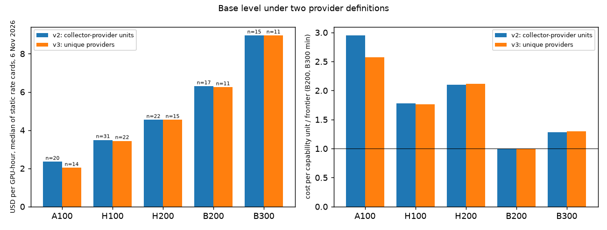
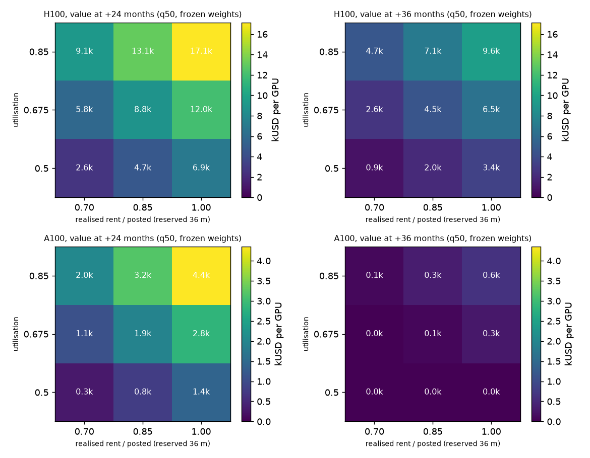

# H100 and A100 rent and resale in 2 to 3 years, version 3 (slug `longrun3`)

Data: gpu-price-pack v0.1.1-handover, rows to 2026-11-06 (origin unchanged). AWS spot ends 2026-10-31. BLS PPI through Sep 2026.
Version 2 (`longrun.md`) and version 1 (`longrun_v1.md`) are kept unchanged. Version 3 fixes errors and overreach that an independent adviser found (`../../advisor/advice.md` s3 item 6, s4 items 6 to 8, s7). It adds no scenario and changes no frozen input: the scenario rates, the 0.25 noise and the 0.35 / 0.40 / 0.25 probabilities are those of `../protocol_v2.yaml`. The rules for this version were written in `../protocol_v3.yaml` before any version 3 code ran.

Reproduce (about 20 s after v2's `aws.py` has written `runs/longrun/`):
`OMP_NUM_THREADS=2 .venv/bin/python experiments/longrun/code/panel_v3.py && OMP_NUM_THREADS=2 .venv/bin/python experiments/longrun/code/scen_v3.py && .venv/bin/python experiments/longrun/code/figures_v3.py && .venv/bin/python experiments/longrun/code/insight_v2_check.py`.
Every table below is copied from `v3_tables.md`, which `scen_v3.py` writes, or from the CSV named next to it.

## Summary in plain language

1. **Rent in 2 years.** A typical H100 rate card (3.44 USD per GPU-hour today) lands between **1.1 and 4.4** (middle 2.1 to 2.4). An A100 80GB (2.03 today) lands between **0.8 and 2.7** (middle 1.5 to 1.6).
2. **Rent in 3 years.** H100 **0.7 to 3.9** (middle 1.6 to 1.9). A100 **0.55 to 2.7** (middle 1.25 to 1.4). These ranges assume the scenarios and their weights are right. With spot-market noise the H100 range at 3 years is 0.4 to 7.2.
3. **Resale value, worked out from future rent (income approach).** An H100 in 2 years is worth **2k to 19k USD** (middle of the range, depending on assumptions), and 0.5k to 10.5k in 3 years. An A100 is worth 0.2k to 4.5k in 2 years and about 0 to 0.7k in 3 years. These figures are model outputs, not observed sale prices: no public record of actual used-GPU sales exists.
4. **What matters most is how busy the GPU is (utilisation), then what share of the posted price is actually collected.** For an H100 in 2 years, going from 50% to 85% utilisation takes the value from 4.7k to 13.1k. Collecting 70% instead of 100% of the posted price cuts it by about half.
5. **No method beat "no change" on any backtest.** That covers one-year aggregator tests and AWS spot from the end of 2023, 2024 and 2025. If prices simply stay where they are, the H100 is worth 15k to 50k in 2 years, far above the scenario middles. Read every number here as a stress range, not a forecast.

## What changed from version 2, and why

| number | v2 | v3 | why |
|---|---|---|---|
| H100 static rate-card level, 6 Nov (USD/GPU-h) | 3.49 | **3.44** | v2 counted 31 collector-provider units. v3 counts 22 unique providers (task 1). |
| A100 80GB level | 2.35 | **2.03** (−13.6%) | 20 units in v2, 14 unique providers in v3. Lambda, Hyperstack, CoreWeave, OVH, Thunder and Vultr were counted twice; most sit above the median. |
| B200 level | 6.30 | 6.25 | 17 units, 11 providers. |
| A100 cost per unit of work vs frontier | 2.95x | **2.57x** | unique-provider levels |
| H100 cost per unit of work vs frontier | 1.78x | 1.77x | unique-provider levels |
| H100 rent +24 m, q50 (q10–q90), frozen weights | 2.31 (1.21–4.17) | 2.28 (1.20–4.12) | new start level plus Monte Carlo noise |
| H100 rent +36 m | 1.79 (0.76–3.76) | 1.76 (0.76–3.69) | same |
| A100 rent +24 m | 1.81 (1.01–3.05) | **1.57 (0.88–2.65)** | lower start level |
| A100 rent +36 m | 1.57 (0.73–3.04) | **1.37 (0.63–2.63)** | same |
| H100 income value q50, Nov 2026 / Nov 2028 / Nov 2029 (v2 inputs) | 26.1k / 10.0k / 5.3k | 26.0k / 10.2k / 5.3k | Monte Carlo only. The income approach takes rent from GetDeploying's reserved 36-month median, not from the panel level. **The headline is now the grid (Table B), not one number.** |
| A100 income value q50 (v2 inputs) | 9.1k / 2.3k / 0.1k | 9.1k / 2.3k / 0.1k | same |
| H100 24 / 36-month loan cover at q10 | 65% / 65% "LTV supported" | **22% to 111%** across the grid, frozen weights | It is now a conditional model output over utilisation and realised rate. v3 also uses the same draws for the loan income and the residual; v2 drew them independently. |
| A100 24 / 36-month loan cover at q10 | 63% / 62% | 10% to 126% / 10% to 130% | same |
| "About two thirds of GetDeploying's rise is panel effect" | stated | **withdrawn** | GetDeploying has no offer rows, so its rise cannot be split into parts (task 2). |
| "v1's 12-month rises are upper bounds" | stated | **withdrawn** | Nothing in the pack observes the static-offer trend before August (task 2). |
| Lender "65% LTV matches market 60–70%", operator "depreciation faster than 6-year straight line", "no impairment on a 6-year schedule" | recommendations | **dropped** | Their direction flips inside the displayed assumptions (Table E). |

Source: `v3_t8_changes_vs_v2.csv` (written by `scen_v3.py`), plus the two withdrawn sentences.

## 1. The instrument

### 1a. Base level: two provider definitions side by side (`v3_t1b_levels_two_definitions.csv`, `v3_t1c_shared_providers.csv`, fig1)

Level = median price of static neocloud on-demand rate cards on 6 Nov 2026. A provider is static if it changes its price on fewer than 2% of offer-days in that collector's sample.

| chip | v2: collector-provider units (n), 90% CI | v3: unique providers (n), 90% CI | providers in both collectors | per-unit ratio vs frontier, v2 / v3 |
|---|---|---|---|---|
| A100 80GB | 2.35 (20), 1.48–2.70 | **2.03 (14)**, 1.45–2.60 | 6 | 2.95 / **2.57** |
| H100 | 3.49 (31), 3.20–3.95 | **3.44 (22)**, 3.02–3.95 | 9 | 1.78 / 1.77 |
| H200 | 4.54 (22) | 4.54 (15) | 7 | 2.10 / 2.12 |
| B200 | 6.30 (17) | 6.25 (11) | 6 | 1.00 / 1.00 |
| B300 | 8.96 (15) | 8.96 (11) | 4 | 1.28 / 1.29 |

**Reconciliation rule** (frozen in protocol_v3): a provider quoted by both collectors gets one price, the geometric mean of its two collector prices. In 24 of the 32 shared provider-chip pairs the two collectors give the identical price, and in 3 more the prices are within 0.2% (CoreWeave and others). The exceptions are Lambda (+13 to +17 log points on gpurentalprices, which already shows Lambda's announced November rates) and Hyperstack (A100 +9, H100 −12 log points). Two other rules give the same five medians: "take gpurentalprices' price" and "take fastgpu's price". The rule matters less than the deduplication itself.

**How much each headline moves.** The A100 level falls 13.6%, and the A100 rent paths and per-unit ratio fall with it. The H100 level falls 1.4%. B200 falls 0.8%, and H200 and B300 do not move. The income-approach values and the loan covers do not depend on this level (see the change table).

### 1b. What is measured about the autumn 2026 rise, and what is not (`v3_t1_same_offer_change.csv`)

Only two collectors in the pack have offer rows: gpurentalprices (4 Aug to 6 Nov) and fastgpu (8 Sep to 6 Nov). On those two, the change is measured for the same static offers present on both dates. Values are in log points.

| chip | gpurentalprices: posted median / same static offers (n, up / down) | fastgpu: posted median / same static offers (n, up / down) |
|---|---|---|
| A100 80GB / SXM | +2.0 / 0.0 (9, 0 / 0) | +13.7 / +6.4 (8, 1 / 0) |
| H100 | +16.6 / +5.7 (12, 3 / 0) | +1.9 / +8.7 (8, 3 / 0) |
| H200 | +4.7 / +6.6 (8, 3 / 0) | +3.6 / +8.1 (8, 3 / 0) |
| B200 | +16.5 / +7.9 (5, 2 / 0) | +0.8 / +9.7 (7, 3 / 0) |
| B300 | +16.6 / +9.5 (2, 1 / 0) | +12.4 / +7.5 (5, 2 / 0) |

- **Measured:** on the same static offers, prices rose about 6 to 10 log points on H100, H200, B200 and B300, and 0 to 6 on A100. A few providers stepped up and none stepped down.
- **The gap between the posted median and the same-offer change runs both ways.** On gpurentalprices H100 the posted median rose 11 points more than the same offers. On fastgpu it rose 7 points less. So the posted median can overstate or understate the common movement.
- **Not observed:**
  - how GetDeploying's weekly median (H100 +16.9, A100 0.0 log points, 3 Aug to 26 Oct) splits between provider mix and repricing, because GetDeploying has no offer rows;
  - the same-offer trend before August 2026 on any collector, so version 1's twelve-month rises (H100 +26, A100 +11 on GetDeploying) cannot be called upper bounds or anything else about the static market;
  - capacity weights (each provider counts once, whatever its size) and transacted prices.

## 2. Scenarios (unchanged from v2)

S1 shortage persists through 2027 (H100 +10%/yr in year 1, A100 0%), S2 eases to the multi-year trend (H100 −20%/yr, A100 −10%/yr), S3 successor glut in months 12 to 30 (H100 −45%/yr, A100 −40%/yr). Level noise is 0.25 log per √year. The evidence and the quoted sources are in `longrun.md` s2 and are not repeated here. Version 3 changes only the **weights shown**: the frozen 0.35 / 0.40 / 0.25 and two alternatives that move 0.15 from S2 toward shortage (0.50 / 0.25 / 0.25) or toward glut (0.35 / 0.25 / 0.40). Each scenario has 20,000 simulated paths. A weight set mixes the three pools, so the tables differ only by the stated input.

## 3. The decision table

### Table A. Posted rent, static rate-card median, unique providers (USD/GPU-h) (`v3_t2_rent_by_weights.csv`)

| chip, horizon | no change | frozen 0.35/0.40/0.25: q50 (q10-q90) | toward shortage 0.50/0.25/0.25 | toward glut 0.35/0.25/0.40 | frozen, spot-level noise 0.60: q10-q90 | frozen, v2 collector-provider base: q50 (q10-q90) |
|---|---|---|---|---|---|---|
| H100, +12 months | 3.44 | 3.05 (2.08-4.64) | 3.22 (2.16-4.89) | 3.05 (2.08-4.64) | 1.36-6.88 | 3.10 (2.11-4.71) |
| H100, +24 months | 3.44 | 2.28 (1.20-4.12) | 2.41 (1.23-4.36) | 2.14 (1.09-4.03) | 0.69-7.15 | 2.31 (1.21-4.18) |
| H100, +36 months | 3.44 | 1.76 (0.76-3.69) | 1.86 (0.78-3.89) | 1.62 (0.66-3.58) | 0.39-7.19 | 1.79 (0.77-3.75) |
| A100, +12 months | 2.03 | 1.89 (1.35-2.66) | 1.92 (1.37-2.72) | 1.89 (1.36-2.66) | 0.87-4.14 | 2.19 (1.57-3.08) |
| A100, +24 months | 2.03 | 1.57 (0.88-2.65) | 1.60 (0.89-2.71) | 1.48 (0.80-2.57) | 0.50-4.82 | 1.82 (1.02-3.07) |
| A100, +36 months | 2.03 | 1.37 (0.63-2.63) | 1.39 (0.64-2.68) | 1.25 (0.55-2.52) | 0.32-5.36 | 1.58 (0.73-3.04) |

The weights move the middle by about ±0.15 USD on H100 and less on A100. The noise assumption matters far more. At spot-level noise (0.60, which backtest c favoured for spot) the q10 to q90 range is about 2.2 to 2.4 times wider. At +12 months the glut weights equal the frozen ones because the glut starts in month 12.

### Table B. Income-approach value per GPU (USD) (`v3_t3_value_grid.csv`, fig2)

Value = present value of (rent × realised/posted × utilisation − fixed opex − power × utilisation) × 730 h per month, over the remaining life. Rent comes from the GetDeploying reserved 36-month median (H100 2.97, A100 1.36) moved along the scenario paths. "Posted" in "realised / posted" means that reserved ask. Discount rate (10 to 20%), remaining life (H100 4 to 7 years, A100 2 to 5 years), fixed opex and power are drawn as in v2, and the same draws are used in every cell. Each cell gives the frozen-weight q50 (q10–q90), the q50 under the shortage / glut weights, and the q50 if the rent never changes.

**H100**

| utilisation | realised / posted | Nov 2026 frozen | +24 m frozen | +24 m shortage / glut | +24 m no change | +36 m frozen | +36 m shortage / glut | +36 m no change |
|---|---|---|---|---|---|---|---|---|
| 0.5 | 0.70 | 10.0k (4.2k-23.9k) | 2.6k (0.0k-14.8k) | 3.2k / 1.9k | 15.1k | 0.9k (0.0k-10.0k) | 1.1k / 0.5k | 11.5k |
| 0.5 | 0.85 | 14.5k (6.6k-31.8k) | 4.7k (0.0k-20.0k) | 5.4k / 3.8k | 20.5k | 2.0k (0.0k-13.7k) | 2.4k / 1.5k | 15.6k |
| 0.5 | 1.00 | 19.1k (9.1k-39.7k) | 6.9k (0.3k-25.2k) | 7.8k / 5.8k | 25.8k | 3.4k (0.0k-17.4k) | 3.9k / 2.6k | 19.6k |
| 0.675 | 0.70 | 16.9k (7.9k-36.2k) | 5.8k (0.1k-22.9k) | 6.6k / 4.7k | 23.5k | 2.6k (0.0k-15.8k) | 3.1k / 2.0k | 17.8k |
| 0.675 | 0.85 | 23.2k (11.4k-46.9k) | 8.8k (0.6k-30.0k) | 9.9k / 7.5k | 30.7k | 4.5k (0.0k-20.8k) | 5.1k / 3.6k | 23.3k |
| 0.675 | 1.00 | 29.6k (15.1k-57.6k) | 12.0k (1.3k-37.0k) | 13.2k / 10.4k | 37.8k | 6.5k (0.1k-25.9k) | 7.2k / 5.4k | 28.7k |
| 0.85 | 0.70 | 24.1k (11.8k-48.7k) | 9.1k (0.6k-31.1k) | 10.2k / 7.7k | 31.8k | 4.7k (0.0k-21.5k) | 5.3k / 3.7k | 24.1k |
| 0.85 | 0.85 | 32.1k (16.5k-62.1k) | 13.1k (1.5k-39.9k) | 14.4k / 11.4k | 40.8k | 7.1k (0.1k-27.9k) | 7.9k / 5.9k | 31.0k |
| 0.85 | 1.00 | 40.1k (21.3k-75.7k) | 17.1k (2.8k-48.9k) | 18.7k / 15.0k | 49.8k | 9.6k (0.5k-34.3k) | 10.5k / 8.2k | 37.8k |

**A100 80GB**

| utilisation | realised / posted | Nov 2026 frozen | +24 m frozen | +24 m shortage / glut | +24 m no change | +36 m frozen | +36 m shortage / glut | +36 m no change |
|---|---|---|---|---|---|---|---|---|
| 0.5 | 0.70 | 2.5k (0.7k-6.8k) | 0.3k (0.0k-3.6k) | 0.3k / 0.2k | 1.9k | 0.0k (0.0k-1.7k) | 0.0k / 0.0k | 0.6k |
| 0.5 | 0.85 | 4.4k (1.6k-9.8k) | 0.8k (0.0k-5.3k) | 0.8k / 0.5k | 3.1k | 0.0k (0.0k-2.7k) | 0.0k / 0.0k | 1.1k |
| 0.5 | 1.00 | 6.3k (2.8k-12.9k) | 1.4k (0.0k-7.1k) | 1.5k / 1.0k | 4.3k | 0.0k (0.0k-3.6k) | 0.0k / 0.0k | 1.5k |
| 0.675 | 0.70 | 5.4k (2.2k-11.5k) | 1.1k (0.0k-6.3k) | 1.2k / 0.8k | 3.8k | 0.0k (0.0k-3.2k) | 0.0k / 0.0k | 1.3k |
| 0.675 | 0.85 | 8.0k (3.8k-15.6k) | 1.9k (0.0k-8.6k) | 2.0k / 1.5k | 5.4k | 0.1k (0.0k-4.5k) | 0.1k / 0.0k | 1.8k |
| 0.675 | 1.00 | 10.6k (5.6k-19.8k) | 2.8k (0.1k-11.0k) | 2.9k / 2.3k | 7.0k | 0.3k (0.0k-5.8k) | 0.3k / 0.1k | 2.4k |
| 0.85 | 0.70 | 8.3k (4.0k-16.3k) | 2.0k (0.0k-9.0k) | 2.1k / 1.6k | 5.6k | 0.1k (0.0k-4.7k) | 0.1k / 0.0k | 1.9k |
| 0.85 | 0.85 | 11.6k (6.2k-21.5k) | 3.2k (0.1k-11.9k) | 3.3k / 2.6k | 7.6k | 0.3k (0.0k-6.4k) | 0.4k / 0.2k | 2.6k |
| 0.85 | 1.00 | 15.0k (8.5k-26.7k) | 4.4k (0.3k-14.9k) | 4.5k / 3.6k | 9.6k | 0.6k (0.0k-8.1k) | 0.7k / 0.4k | 3.3k |

**Reading Table B:**
- **Utilisation and realised rate dominate.** Each moves the H100 +24-month middle by a factor of about 2 to 3 across its range. The scenario weights move it by about ±10 to 30%.
- **"No change" dominates everything.** If the rent stays flat, the H100 is worth 15k to 50k at +24 months, which is above the frozen-weight q90 in all nine cells. No backtest has shown that the scenario model predicts a fall better than "no change" does (Table D). Treat the gap between the two columns as the size of the bet that rents fall.
- **The A100 at +36 months is close to 0 in every scenario cell.** It is 0.6k to 3.3k even with flat rent. That rests on the assumed 2 to 5 years of remaining life; an A100 would be about 9 years old in late 2029. V100s still rented at age 9 in 2026 (CCIR, cited in v2), so a longer life is possible and would raise this value.
- **Compare with published used prices:** H100 18k to 22k, A100 80GB 5k to 9.5k. These are mostly asking prices, cited in v2 s4. For the H100 they sit between the Nov 2026 cells at 0.5 utilisation with full realised rent (19.1k) and at 0.675 utilisation with 0.70 to 0.85 realised rent (16.9k to 23.2k). This is a consistency check, not a validation: none of them is a transaction.

### Table C. Loan cover at q10 as a share of the used-market price (H100 20k, A100 7k) (`v3_t4_lender_grid.csv`)

Cover = 10th percentile of (PV at a 10% loan rate of net income over the loan term + PV of the income value at maturity). It is the q10 of a model output under the stated inputs. **It is not an advance rate and it is not calibrated on any default or recovery data.**

| chip, loan | utilisation | realised / posted | frozen | toward shortage | toward glut | no change in rent |
|---|---|---|---|---|---|---|
| H100, 24 m | 0.5 | 0.70 | 0.22 | 0.23 | 0.21 | 0.93 |
| H100, 24 m | 0.5 | 0.85 | 0.34 | 0.36 | 0.33 | 1.27 |
| H100, 24 m | 0.5 | 1.00 | 0.47 | 0.50 | 0.45 | 1.61 |
| H100, 24 m | 0.675 | 0.70 | 0.41 | 0.43 | 0.39 | 1.47 |
| H100, 24 m | 0.675 | 0.85 | 0.59 | 0.62 | 0.56 | 1.92 |
| H100, 24 m | 0.675 | 1.00 | 0.79 | 0.82 | 0.74 | 2.38 |
| H100, 24 m | 0.85 | 0.70 | 0.61 | 0.64 | 0.58 | 1.99 |
| H100, 24 m | 0.85 | 0.85 | 0.86 | 0.89 | 0.81 | 2.56 |
| H100, 24 m | 0.85 | 1.00 | 1.11 | 1.15 | 1.05 | 3.13 |
| H100, 36 m | 0.5 | 0.70 | 0.22 | 0.23 | 0.21 | 0.95 |
| H100, 36 m | 0.5 | 0.85 | 0.34 | 0.36 | 0.33 | 1.30 |
| H100, 36 m | 0.5 | 1.00 | 0.47 | 0.50 | 0.45 | 1.64 |
| H100, 36 m | 0.675 | 0.70 | 0.41 | 0.43 | 0.39 | 1.49 |
| H100, 36 m | 0.675 | 0.85 | 0.59 | 0.62 | 0.56 | 1.96 |
| H100, 36 m | 0.675 | 1.00 | 0.79 | 0.82 | 0.74 | 2.42 |
| H100, 36 m | 0.85 | 0.70 | 0.62 | 0.64 | 0.58 | 2.03 |
| H100, 36 m | 0.85 | 0.85 | 0.86 | 0.89 | 0.81 | 2.61 |
| H100, 36 m | 0.85 | 1.00 | 1.11 | 1.16 | 1.05 | 3.18 |
| A100, 24 m | 0.5 | 0.70 | 0.10 | 0.10 | 0.10 | 0.38 |
| A100, 24 m | 0.5 | 0.85 | 0.24 | 0.25 | 0.23 | 0.67 |
| A100, 24 m | 0.5 | 1.00 | 0.41 | 0.42 | 0.39 | 0.95 |
| A100, 24 m | 0.675 | 0.70 | 0.33 | 0.34 | 0.31 | 0.82 |
| A100, 24 m | 0.675 | 0.85 | 0.57 | 0.58 | 0.54 | 1.19 |
| A100, 24 m | 0.675 | 1.00 | 0.82 | 0.84 | 0.78 | 1.54 |
| A100, 24 m | 0.85 | 0.70 | 0.60 | 0.61 | 0.57 | 1.24 |
| A100, 24 m | 0.85 | 0.85 | 0.92 | 0.94 | 0.87 | 1.69 |
| A100, 24 m | 0.85 | 1.00 | 1.26 | 1.28 | 1.19 | 2.13 |
| A100, 36 m | 0.5 | 0.70 | 0.10 | 0.11 | 0.10 | 0.43 |
| A100, 36 m | 0.5 | 0.85 | 0.25 | 0.25 | 0.23 | 0.78 |
| A100, 36 m | 0.5 | 1.00 | 0.42 | 0.43 | 0.39 | 1.11 |
| A100, 36 m | 0.675 | 0.70 | 0.33 | 0.34 | 0.31 | 0.96 |
| A100, 36 m | 0.675 | 0.85 | 0.58 | 0.59 | 0.54 | 1.42 |
| A100, 36 m | 0.675 | 1.00 | 0.84 | 0.86 | 0.79 | 1.87 |
| A100, 36 m | 0.85 | 0.70 | 0.61 | 0.62 | 0.57 | 1.48 |
| A100, 36 m | 0.85 | 0.85 | 0.95 | 0.96 | 0.88 | 2.05 |
| A100, 36 m | 0.85 | 1.00 | 1.30 | 1.32 | 1.22 | 2.62 |

The H100 cover reaches 0.60 in only 12 of the 27 cells (each loan term), all at utilisation 0.675 or more and none at 0.5. With flat rent it is 0.93 or more everywhere. The 24 and 36-month covers are almost equal: the extra year of income offsets the lower residual.

### Table D. Backtests already reported in v2, next to the table (`v3_t7_backtests_by_origin.csv`, from `v2_t3c`; not re-run, not tuned)

AWS spot, V100 p3 / A100 p4d / H100 p5 / H200 p5en, horizons 12 and 24 months. Some targets are cut short at Oct 2026.

| variant | origin | n | 80% coverage, method / no change | mean abs log error, method / no change | method better on error? |
|---|---|---|---|---|---|
| as_run_then_noise0.25 | 2023-12 | 6 | 0.00 / 0.33 | 1.20 / 0.73 | no |
| as_run_then_noise0.25 | 2024-12 | 5 | 0.40 / 0.60 | 0.71 / 0.33 | no |
| as_run_then_noise0.25 | 2025-12 | 3 | 0.00 / 0.00 | 0.53 / 0.52 | no |
| as_run_then_noise0.60 | 2023-12 | 6 | 0.33 / 0.50 | 1.20 / 0.73 | no |
| as_run_then_noise0.60 | 2024-12 | 5 | 0.80 / 1.00 | 0.69 / 0.33 | no |
| as_run_then_noise0.60 | 2025-12 | 3 | 1.00 / 1.00 | 0.52 / 0.52 | no |
| frozen_v2_rates_noise0.60 | 2023-12 | 6 | 0.67 / 0.50 | 0.75 / 0.73 | no |
| frozen_v2_rates_noise0.60 | 2024-12 | 5 | 1.00 / 1.00 | 0.44 / 0.33 | no |
| frozen_v2_rates_noise0.60 | 2025-12 | 3 | 0.67 / 1.00 | 0.60 / 0.52 | no |

The one-year aggregator test (v2_t3a, GetDeploying, origin Nov 2025, 16 series) put 11 of 16 truths (0.69) inside q10 to q90. Its mean absolute log error was 0.48, against 0.39 for no change. **The method is worse than "no change" on error at every origin and in every variant (equal to two decimals once, 2025 as run).** The "frozen v2 rates" rows use rates set with 2026 hindsight, so they are not out of sample. The cell counts are small (3 to 6 per origin).

## 4. Sanity checks (`v3_t5_sanity.csv`)

Both properties hold. Each check compares the same simulated draws, so any violation would show up draw by draw.
- **P1, lower utilisation or lower realised rent never raises value.** Checked for every draw across the 3 × 3 grid, at Nov 2026, +24 and +36 months, for both chips: 12 checks, worst per-draw violation ≤ 0. The displayed q50s are also monotone in both inputs under every weight set: 6 checks.
- **P2, higher costs never raise value.** Fixed opex +0.10 USD/GPU-h, power price ×1.5 and discount rate +5 points, each checked separately at the midpoint cell for both chips and three dates: 18 checks, worst per-draw violation ≤ 0. At +24 and +36 months the worst case is exactly 0, from draws already worth 0.

## 5. Conditional recommendations (`v3_t6_recommendation_tests.csv`)

Each version 2 recommendation was given a direction test before running (protocol_v3 task 4). The test covers the 27 cells (3 utilisation × 3 realised rate × 3 weight sets), or the 3 weight sets for rent, which does not depend on the other two. A recommendation whose direction changes inside the displayed assumptions is dropped.

| id | test | cells holding | statistic range | verdict | no change agrees? |
|---|---|---|---|---|---|
| R1 | H100 q50 posted rent at +24m / 6 Nov level < 1 | 3 of 3 | 0.623 to 0.701 | keep (conditional) | no |
| R2 | A100 q50 posted rent at +24m / 6 Nov level < 1 | 3 of 3 | 0.728 to 0.787 | keep (conditional) | no |
| R3 | A100 q50 value +36m / q50 value Nov 2026 < 0.10 | 27 of 27 | 0 to 0.0436 | keep (conditional) |  |
| R4_24m | H100 24-month loan: q10 cover / 20k >= 0.60 | 12 of 27 | 0.209 to 1.15 | DROP |  |
| R4_36m | H100 36-month loan: q10 cover / 20k >= 0.60 | 12 of 27 | 0.209 to 1.16 | DROP |  |
| R5 | H100 q50 value at +36m < 10.5k (35% of 30k) | 27 of 27 | 506 to 1.05e+04 | keep (conditional) |  |
| R6 | H100 q90 posted rent at +12m / 6 Nov level > 1 | 3 of 3 | 1.35 to 1.42 | keep (conditional) | yes |
| R7 | per-unit ratio vs frontier > 1 (H100, A100; v2 units and v3 unique) | 4 of 4 | 1.77 to 2.95 | keep (conditional) | yes |
| R8 | H100 q50 value Nov 2026 - Nov 2028 > 10k (2 years of 6-year straight line) | 22 of 27 | 7.33e+03 to 2.4e+04 | DROP |  |
| R9 | H100 q50 value Nov 2026 > 15k (6-year straight-line book at age 3) | 22 of 27 | 9.29e+03 to 4.27e+04 | DROP |  |

**Dropped**
- **R4:** "the q10 path supports about 65% loan-to-value, matching the market's 60 to 70% advance rates". The cover ranges from 21% to 115% of 20k across the displayed assumptions. 65% was one point in that range.
- **R8:** "H100 economic depreciation in 2027 to 2028 is faster than 6-year straight line". It fails in 5 of 27 cells, all at 0.5 utilisation with 0.70 or 0.85 realised rent. There the GPU is already worth less than 15k, so it has less value left to lose.
- **R9:** "no impairment on a 6-year schedule". The Nov 2026 value falls below the 15k book in the same 5 cells (9.3k to 14.5k).
- **Withdrawn without a formal test:** v2's line "a 35% residual is the median case at 24 months". Table B's +24-month middles run from 1.9k to 18.7k, which is 6% to 62% of 30k.

**Kept, worded as conditions**
- **Lessor (R1, R2).** *If* the scenario model and its weights hold, the middle H100 static rate card at +24 months is 2.14 to 2.41 against 3.44 today, and A100 1.48 to 1.60 against 2.03. A multi-year lease whose economics need today's rent to hold would then be exposed. "No change", which beat every method on every backtest, says the rent stays where it is. The model gives no evidence for preferring the fall. What it shows is how much a lessor loses if the fall happens.
- **Lessor, A100 term (R3).** Under every displayed assumption the A100's income value at +36 months is under 5% of its Nov 2026 value. This follows from the assumed 2 to 5 years of remaining life as much as from rent. Even with flat rent the value is 0.6k to 3.3k. An A100 lease running past 2029 would therefore rest on residual value that this model does not support. The model cannot show that such a lease is unsafe.
- **Lender (R5, and Table C instead of R4).** Under every displayed assumption the middle H100 income value at +36 months is at or below 35% of 30k: 0.5k to 10.5k. The margin in the most favourable cell is 0.2% (10.48k against 10.5k), which is within simulation noise. So a 35% residual at 36 months, the figure in the Corvex lease cited in v2, requires utilisation near 85%, near-full realised rent and shortage weights. Or it requires rents not to fall at all. Table C shows how loan cover moves with utilisation and realised rate. Read it as a stress table. A removal sensitivity or a scenario q10 is not a calibrated haircut, and posted asks are not realised revenue.
- **Reserved-capacity buyer (R6).** Under every weight set the model's +12-month q90 for H100 is 1.35 to 1.42 times today's rate (4.64 to 4.89). A 12-month reservation at today's rate removes that upside tail. Whether that is worth paying for depends on the weight given to shortage (0.35 to 0.50 here), and the model cannot test that weight.
- **Buyer, per unit of work (R7).** On today's posted static rate cards, H100 costs 1.77 to 1.78 times the frontier per unit of inference work and A100 2.57 to 2.95 times, under either provider definition. This is a measurement of posted asks on one day, not a forecast. It favours older chips only for jobs that need them, such as memory fit or availability.

## 6. Assumptions and what is not tested

- **Not tested at all:**
  - the scenario probabilities;
  - any horizon beyond 24 months;
  - the static-offer trend before August 2026;
  - resale values, since there is no transaction-level resale series;
  - realised rental revenue, since only posted asks are public.
- **The income approach depends on assumptions that are not data:**
  - utilisation and realised rate (shown on the grid);
  - remaining life, discount rate, opex and power (drawn as in v2, not on the grid);
  - GetDeploying's reserved 36-month median as the posted rent;
  - excluding the server and network share from the GPU's value.
- **Noise** stays at 0.25 log per √year for static rate cards, as frozen. Backtest c favoured 0.60 for spot. The 0.60 bands are shown in Table A for display, and nothing was re-tuned.
- **Provider weighting:** equal weight per unique provider, because capacity shares are unknown. A provider-balanced, causal index is being built separately in `experiments/index/`. That is the implementable version of the "static rate-card" instrument used here. The static/dynamic classification used in this report looks at each provider's whole sample (see `../../insight/results/insight_v2.md`).

## Acceptance (protocol_v3)

| check | result |
|---|---|
| origin 2026-11-06, no new historical selection, frozen rates / noise / probabilities unchanged | held |
| every number produced by v3 code or read from a named v2 file by it | held (`panel_v3.py`, `scen_v3.py`, `insight_v2_check.py`; v2_t3a / v2_t3c read by `scen_v3.py`) |
| sanity properties P1 and P2 | held (36 checks) |
| nothing presented as a calibrated lending rule | held; R4 dropped, Table C labelled as a model output |
